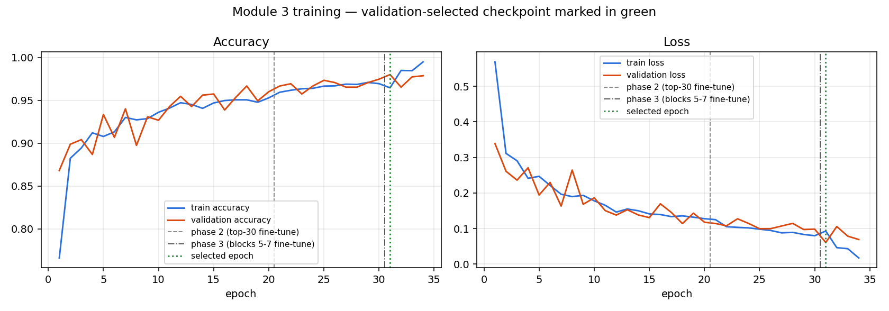
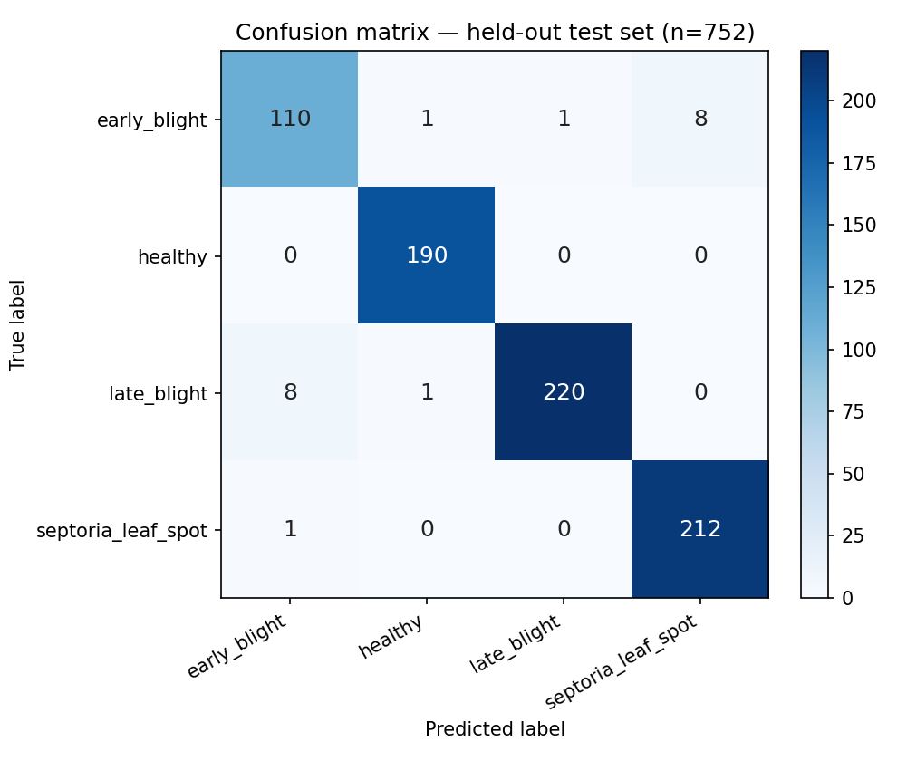
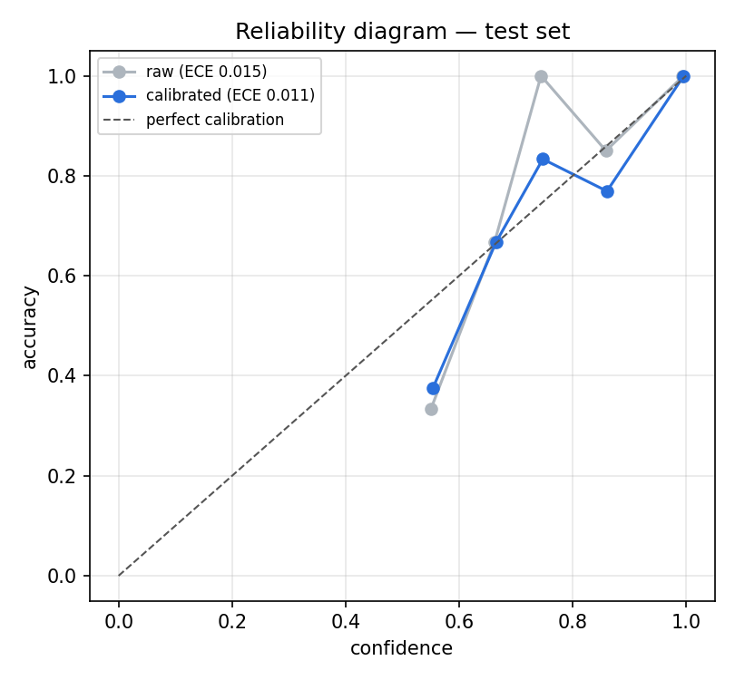
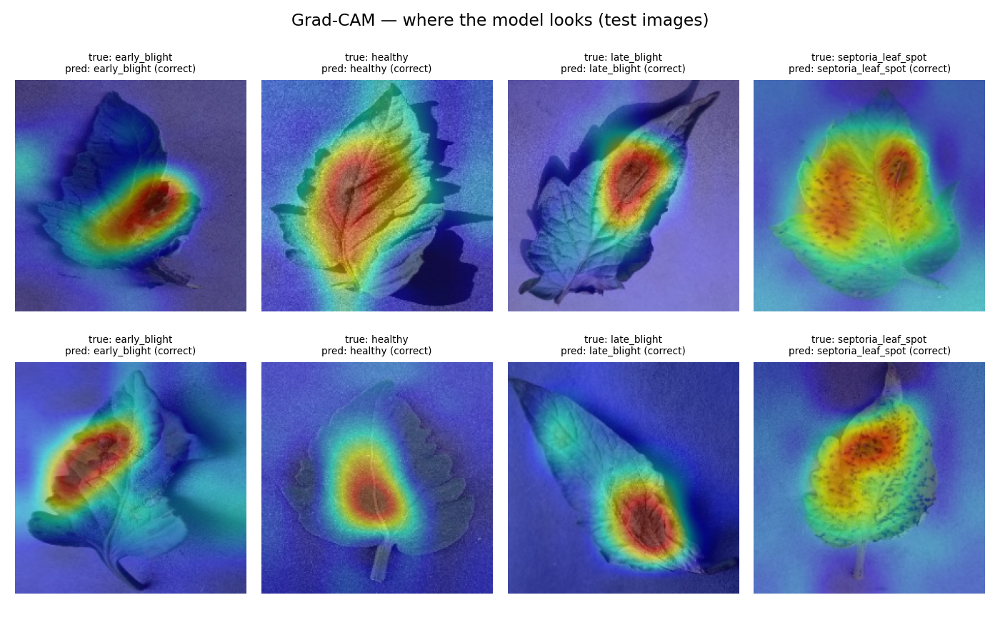

# Module 3: Disease Classification. Final report (70 / 15 / 15 rebuild)

Every number below comes from the artifact files listed in section 5. `python scripts/write_m3_report.py` regenerates this report.

## 0. What was wrong before, and what changed

| Finding in the old notebooks | Fix |
|---|---|
| The "test" set was a `validation_split=0.1` subset of the same folder, so it sat inside the 20 % validation split that was also used to choose the checkpoint. The 98.4 % figure was not a held-out result. | A real, disjoint 70/15/15 split. The test set was evaluated once. |
| "10,032 images" was a Windows double count: `glob('*.jpg') + glob('*.JPG')` counts every file twice on a case-insensitive disk. | 5,016 real files were counted with a case-insensitive extension check. |
| `prepared_dataset/` was thought to be stale. It actually held all 5,016 files, and 9 of them were byte-identical duplicates. | The folder was moved to `data/datasets/plantvillage_tomato/`. Duplicates were removed by SHA-256 before splitting, and overlap is checked by path **and** by hash. |
| No seed-controlled split, no stratification, no manifest. | `train_test_split(..., stratify=labels, random_state=42)` is called twice, and `split_manifest.json` lists every image. |
| The old `best.keras` came from Phase 1. Its config shows the backbone frozen and lr = 1e-3, and its optimizer state covers only the 4 head tensors. Phase 2 never beat it. | Recorded here. Its frozen ImageNet backbone was recovered and verified (see 2.1), and a completely new head was trained. |

## 1. Dataset

- **Source:** PlantVillage (tomato subset: early_blight, healthy, late_blight, septoria_leaf_spot)
- **Path:** `data/datasets/plantvillage_tomato/<class>/`
- **Raw files:** 5016 (early_blight 800, healthy 1273, late_blight 1526, septoria_leaf_spot 1417)
- **Exact duplicates removed:** 9 (all within the same class). **Unreadable:** 0. **Label conflicts:** 0.
- **Unique images used:** 5007
- **Split method:** sklearn.model_selection.train_test_split called twice, stratify=labels, random_state=RANDOM_SEED: (1) 70% train vs 30% holdout; (2) holdout 50/50 -> validation/test
- **Seed:** `RANDOM_SEED = 42`, passed as `random_state=RANDOM_SEED` to both `train_test_split` calls in `scripts/m3_train_classifier.py::stage_split`.

| class | total | train | validation | test |
|---|---:|---:|---:|---:|
| early_blight | 800 | 560 | 120 | 120 |
| healthy | 1269 | 888 | 191 | 190 |
| late_blight | 1521 | 1064 | 228 | 229 |
| septoria_leaf_spot | 1417 | 992 | 212 | 213 |
| **all** | **5007** | **3504** | **751** | **752** |

The split fractions are 0.6998 / 0.1500 / 0.1502. The small differences from exactly 70/15/15 come from rounding per class: sklearn rounds each stratum to whole images, so validation and test differ by at most one image per class.

**Leakage checks** (from the manifest):

- `path_overlap_train_validation`: **0**
- `hash_overlap_train_validation`: **0**
- `path_overlap_train_test`: **0**
- `hash_overlap_train_test`: **0**
- `path_overlap_validation_test`: **0**
- `hash_overlap_validation_test`: **0**
- `every_unique_image_in_exactly_one_split`: **True**
- `dropped_duplicates_absent_from_splits`: **True**
- Augmentation is applied only in the training `tf.data` pipeline. The validation and test pipelines only cast to float32.
- The test split is loaded only inside `stage_evaluate`. `TEST_EVALUATED.lock` blocks a second evaluation and any further training.

## 2. Model

- **Architecture:** EfficientNetB0(ImageNet) -> GAP -> Dropout(0.3) -> Dense(256, relu) -> Dropout(0.2) -> Dense(4, softmax)
- **Input:** RGB, 224×224, 0–255. Keras `efficientnet.preprocess_input` passes values through unchanged because the model does its own rescaling and normalisation. It does **not** scale to [-1, 1] as the Review-1 slide says.
- **Parameters:** Phase 1 trainable 328,964 / frozen 4,049,571. Phase 2 trainable 1,812,324. Phase 3 trainable 3,994,028.
- **Hyperparameters:**

| key | value |
|---|---|
| image_size | 224 |
| batch_size | 32 |
| epochs_head_max | 20 |
| epochs_finetune_max | 10 |
| lr_head | 0.001 |
| lr_finetune | 1e-05 |
| fine_tune_layers | 30 |
| batchnorm_frozen_in_phase2 | True |
| dropout | 0.3 |
| early_stop_patience | 5 |
| reduce_lr_patience | 3 |
| optimizer | Adam |
| loss | sparse_categorical_crossentropy |
| random_seed | 42 |
| augmentation_train_only | ['random_flip', 'random_rotation', 'random_translation', 'random_zoom', 'random_brightness'] |

### 2.1 ImageNet backbone provenance

Google's weight server is blocked from the training environment. The ImageNet EfficientNetB0 backbone was therefore recovered from the old notebook model, which was verified to be frozen ImageNet weights on three counts:

- its saved config marks all 238 backbone layers `trainable: false`
- its Adam state holds slots only for the 4 head tensors (1280×256, 256, 256×4, 4)
- its Normalization layer holds the official ImageNet mean and variance used by Keras

The old head was discarded and a new head was initialised. The file is `models/pretrained/efficientnetb0_imagenet_notop.weights.h5`. Source recorded by training: `efficientnetb0_imagenet_notop.weights.h5`.

## 3. Training

| phase | what trains | lr | epochs run | minutes | best val acc | min val loss |
|---|---|---|---:|---:|---:|---:|
| phase1 | head only (backbone frozen) | 0.001 | 20 | 34.4 | 0.9667 | 0.1142 |
| phase2 | top 30 backbone layers (BN frozen) | 1e-05 | 10 | 17.8 | 0.9747 | 0.0974 |
| phase3 | blocks 5–7 + top (BN frozen) | 0.0001 | 4 | 9.6 | 0.9800 | 0.0609 |

**Selected checkpoint (validation only):** phase3 epoch 1, val_accuracy 0.9800, val_loss 0.0609. Rule: max val_accuracy, ties broken by min val_loss (validation split only).
Phase 3 was fixed before any test evaluation. It **improved** validation and was accepted.

**Inference settings chosen on validation:** horizontal-flip TTA = True (val acc 0.9800 → 0.9814, NLL 0.0609 → 0.0574). Temperature scaling T = 0.9010 (val ECE 0.0091 → 0.0082). Uncertainty threshold: 0.6.



## 4. Independent test evaluation (single pass)

```text
Total images:            5007  (raw files 5016, 9 exact duplicates removed)
Training:                3504
Validation:              751
Test:                    752

Test Loss:               0.0546
Test Accuracy:           0.9734  (97.34%)

Classification Report:
                    precision    recall  f1-score   support

      early_blight     0.9244    0.9167    0.9205       120
           healthy     0.9896    1.0000    0.9948       190
       late_blight     0.9955    0.9607    0.9778       229
septoria_leaf_spot     0.9636    0.9953    0.9792       213

          accuracy                         0.9734       752
         macro avg     0.9683    0.9682    0.9681       752
      weighted avg     0.9736    0.9734    0.9733       752

Macro F1:                0.9681
Weighted F1:             0.9733

Confusion Matrix (rows = true, cols = predicted):
                        early_blight       healthy   late_blight  septoria_lea
early_blight                     110             1             1             8
healthy                            0           190             0             0
late_blight                        8             1           220             0
septoria_leaf_spot                 1             0             0           212

Total test samples:      752
Correct predictions:     732
Incorrect predictions:   20

Production inference mode (chosen on validation): TTA=True, temperature=0.9010
   accuracy                         : 0.9787
   ECE raw -> calibrated            : 0.0150 -> 0.0107
   plants with conf >= 0.60        : 742/752 (98.7%)
   accuracy on confident plants     : 0.9865
   flagged uncertain                : 10 (of which wrong: 6)
```

| class | precision | recall | F1 | support |
|---|---:|---:|---:|---:|
| early_blight | 0.9244 | 0.9167 | 0.9205 | 120 |
| healthy | 0.9896 | 1.0000 | 0.9948 | 190 |
| late_blight | 0.9955 | 0.9607 | 0.9778 | 229 |
| septoria_leaf_spot | 0.9636 | 0.9953 | 0.9792 | 213 |
| **macro** | 0.9683 | 0.9682 | **0.9681** | 752 |
| **weighted F1** | | | **0.9733** | |



**Production inference mode** (TTA=True, T=0.901): accuracy 0.9787; ECE 0.0150 → 0.0107; 98.7% of test images have confidence ≥ 0.6 and those are 98.65% correct; 10 images are flagged for manual inspection.





**Comparison with earlier figures:** the notebook's 98.4 % (500 images nested in validation) and the previously assumed 96.68 % / 96.17 % macro F1 (never produced by any file) are **not** comparable. The numbers above are the only held-out results.

## 5. Artifacts

- `models/classification/split_manifest.json`
- `models/classification/split_manifest.csv`
- `models/classification/class_order.json`
- `models/classification/inference_config.json`
- `models/classification/best.keras`
- `models/classification/best.keras.bak-20260916-061314`
- `models/classification/eval/training_history.json`
- `models/classification/eval/history_phase1.csv`
- `models/classification/eval/history_phase2.csv`
- `models/classification/eval/history_phase3.csv`
- `models/classification/eval/metrics.json`
- `models/classification/eval/classification_report.txt`
- `models/classification/eval/classification_report.csv`
- `models/classification/eval/confusion_matrix.png`
- `models/classification/eval/confusion_matrix.csv`
- `models/classification/eval/confusion_matrix.json`
- `models/classification/eval/test_predictions.csv`
- `models/classification/eval/misclassified.csv`
- `models/classification/eval/reliability_diagram.png`
- `models/classification/eval/gradcam_examples.png`
- `models/classification/eval/training_curves.png`
- `models/classification/eval/test_evaluation_printout.txt`
- `models/classification/eval/split_summary.json`
- `models/classification/eval/promotion_record.json`
- `models/classification/eval/run_log.txt`
- `models/classification/eval/TEST_EVALUATED.lock`
- `models/classification/eval/module3_pytest.txt`
- `notebooks/m3_classification_701515_report.ipynb`

## 6. Verification

```text
Final production model:
  Model path:            models/classification/best.keras
  Model architecture:    EfficientNetB0(ImageNet) -> GAP -> Dropout(0.3) -> Dense(256, relu) -> Dropout(0.2) -> Dense(4, softmax)
  Model evaluated on:    752 test images in split_manifest.json (split == 'test'), manifest SHA256 1f463f1c9b77defa1f98e456281d95ea57b098a1b4007147e0eba303596e9b3e
  Test accuracy:         0.9734
  Macro F1:              0.9681
  SHA256 (new):          499ceca37640900d7d2771dbac1c5f55cf30796875a56b6f4ec584918d92614e
  SHA256 (previous):     4022beccda7eb18dc6759f8e5ef8d2825dd3ed43f0615721b069e997063c3f2c  (backup: models/classification/best.keras.bak-20260916-061314)
  Output shape check:    [None, 4] (probe sum 1.0000) -> PASS
  Promoted == evaluated: True
```

**Module 3 tests** (`pytest tests/test_classification.py -v`): 36 passed in 11.24s

```text
tests/test_classification.py::TestPredictionDataclasses::test_crop_input_construction PASSED
tests/test_classification.py::TestPredictionDataclasses::test_classification_result_construction PASSED
tests/test_classification.py::TestPredictionDataclasses::test_classification_result_custom_model_version PASSED
tests/test_classification.py::TestPredictionDataclasses::test_classification_result_missing_all_probs_key PASSED
tests/test_classification.py::TestDiseaseClassifier::test_classifier_raises_on_missing_weights PASSED
tests/test_classification.py::TestDiseaseClassifier::test_classifier_raises_on_missing_class_order PASSED
tests/test_classification.py::TestDiseaseClassifier::test_classifier_loads_successfully PASSED
tests/test_classification.py::TestDiseaseClassifier::test_classifier_predict_structure_mocked PASSED
tests/test_classification.py::TestDatabaseHelpers::test_ensure_classifications_table_creates PASSED
tests/test_classification.py::TestDatabaseHelpers::test_save_and_fetch_classifications PASSED
tests/test_classification.py::TestDatabaseHelpers::test_delete_classifications_for_survey PASSED
tests/test_classification.py::TestDatabaseHelpers::test_fetch_detections_for_survey PASSED
tests/test_classification.py::TestDatabaseHelpers::test_fetch_detections_for_survey_empty PASSED
tests/test_classification.py::TestClassifyService::test_classify_survey_happy_path PASSED
tests/test_classification.py::TestClassifyService::test_classify_survey_no_detections PASSED
tests/test_classification.py::TestClassifyService::test_classify_survey_missing_image PASSED
tests/test_classification.py::TestClassifyEndpoint::test_api_missing_survey PASSED
tests/test_classification.py::TestClassifyEndpoint::test_api_model_not_found PASSED
tests/test_classification.py::TestClassifyEndpoint::test_api_invalid_body PASSED
tests/test_classification.py::TestClassifyEndpoint::test_api_invalid_body_type PASSED
tests/test_classification.py::TestClassifyEndpoint::test_api_health PASSED
tests/test_classification.py::TestClassifyEndpoint::test_api_successful_classification PASSED
tests/test_classification.py::TestSplitManifest::test_seed_method_and_class_order PASSED
tests/test_classification.py::TestSplitManifest::test_every_image_in_exactly_one_split PASSED
tests/test_classification.py::TestSplitManifest::test_zero_overlap_by_path_and_content_hash PASSED
tests/test_classification.py::TestSplitManifest::test_split_is_70_15_15_and_stratified PASSED
tests/test_classification.py::TestSplitManifest::test_duplicates_were_excluded PASSED
tests/test_classification.py::TestSplitManifest::test_labels_match_folders PASSED
tests/test_classification.py::TestCalibrationAndUncertainty::test_low_confidence_is_flagged_uncertain PASSED
tests/test_classification.py::TestCalibrationAndUncertainty::test_temperature_changes_confidence_not_label PASSED
tests/test_classification.py::TestCalibrationAndUncertainty::test_tta_runs_a_flipped_pass PASSED
tests/test_classification.py::TestCalibrationAndUncertainty::test_mismatched_inference_config_is_ignored PASSED
tests/test_classification.py::TestCalibrationAndUncertainty::test_uncertain_flag_is_persisted PASSED
tests/test_classification.py::TestCalibrationAndUncertainty::test_legacy_table_is_migrated PASSED
tests/test_classification.py::TestProductionModel::test_output_shape_and_inference_on_real_test_image PASSED
tests/test_classification.py::TestProductionModel::test_promoted_model_is_the_evaluated_one PASSED
```

Production inference: `app/classification/classifier.py` loads `best.keras`, checks `class_order.json` against `CLASS_NAMES`, and applies `inference_config.json` (TTA + temperature + uncertainty threshold).

## 7. Final verdict

**Module 3 is COMPLETE.** The model was trained and selected on a verifiable, de-duplicated, stratified, seeded 70/15/15 split with zero path or hash overlap. It was evaluated once on the untouched test split, with every artifact and both SHA-256 hashes recorded, and promoted only after load, shape and inference checks passed. The remaining limitation is domain shift: PlantVillage leaves on plain backgrounds versus real field crops.
