# SmartSpray — Vision-Guided Autonomous UAV for Plant-Level Disease Detection and Variable-Rate Spraying

Complete technical documentation · Team 134 · VIT Chennai · Guide: Rajesh M

## Executive summary

SmartSpray is a software system for **plant-level, disease-aware precision spraying** of tomato crops by drone. It takes a survey image of a field and produces, for every plant, a diagnosis (disease and confidence), a severity estimate, a position in metres, a justified treatment decision with its own dose, and finally a shortest-route spray mission that a drone can fly. Plants that do not need treatment are skipped, so chemical use and flight distance fall sharply compared with spraying the whole field.

The system is built as nine modules (M1–M9) that each read from and write to one SQLite database, so any stage can be re-run, inspected or replaced on its own. It can be used through a REST API, a command-line pipeline, a Streamlit dashboard, a self-contained HTML report and a **3D drone mission simulator** in which the drone marks the field, maps it, photographs every plant, decides and sprays autonomously, and can be taken over by a pilot from the keyboard at any moment.

**Key results**

| Item | Result |
|---|---|
| Disease classifier (M3), held-out test set of 752 images | **97.34 %** accuracy (732/752), macro F1 **0.968** |
| Production inference mode (flip-TTA + temperature scaling) | 97.87 % accuracy, calibration error (ECE) 0.015 → 0.011 |
| Uncertainty gate (confidence < 0.60 → manual inspection) | 98.7 % of plants confident, 98.65 % of those correct |
| Plant detector (M2, YOLOv8n, 29-image test split) | mAP50 0.925 · mAP50-95 0.805 · precision 0.997 · recall 0.912 |
| End-to-end demo field (63 plants, synthetic) | 82 % less chemical than blanket spraying; route 60 % shorter; 19/19 diseased plants acted on; 0/44 healthy plants sprayed |
| 3D mission simulator (63-plant field) | 63/63 plants located (4.3 cm error), 61/63 classified correctly, 80.6 % less chemical, spray route 47 m vs 99 m lawn-mower pass (52 % shorter) |
| Automated tests | 277 passing |

**What this document contains.** Chapter 2 explains the problem and objectives. Chapter 3 gives the architecture. Chapter 4 covers the data. Chapters 5–13 describe each module in depth: purpose, algorithm, code, database tables, API, terminal commands and results. Chapter 7 (Module 3) explains exactly how a plant is classified inside the backend, step by step, with the real code and a worked example. Chapter 14 covers pipeline orchestration and storage, Chapter 15 the interfaces, Chapter 16 the 3D mission simulator, Chapter 17 testing, Chapter 18 the consolidated results, and Chapter 19 a complete terminal guide for running and opening every module. Chapter 20 lists likely review questions with answers. Chapter 21 lists limitations and the remaining work, followed by references and appendices (file-by-file index, configuration files, glossary).

> How to use this for the consolidated report: Chapters 1–4 map to Introduction / Literature / System Design; Chapters 5–16 to Implementation; Chapters 17–18 to Results and Testing; Chapter 21 to Conclusion and Future Work. Every number in this document comes from files in the repository (paths are given), so it can be checked during the review.

## Introduction

### Problem statement

Tomato is one of the most widely grown vegetable crops in India, and fungal and oomycete leaf diseases are among the main causes of yield loss. Three of the most damaging are:

- **Early blight** (*Alternaria solani*): brown concentric-ring lesions, usually on older leaves.
- **Late blight** (*Phytophthora infestans*): dark, water-soaked patches that spread very quickly in cool, humid weather and can destroy a crop in days.
- **Septoria leaf spot** (*Septoria lycopersici*): many small circular spots with pale centres.

Farmers usually respond by spraying the whole field on a fixed schedule ("blanket spraying"). Disease, however, appears in patches. Spraying every plant wastes chemical and money, increases residue on produce, harms soil and water, and exposes the operator. Agricultural drones make spraying faster, but most of them still spray uniformly.

Existing research models stop at the diagnosis of a single leaf photo, and commercial precision sprayers mostly target weeds and come as expensive machines. What is missing is the link from **an image of a field** to **a justified, plant-specific spray action** that a drone can execute.

### Objectives

1. Detect individual tomato plants in a drone survey image and give each one a stable ID.
2. Classify each plant as healthy, early blight, late blight or septoria leaf spot, with a **calibrated** confidence and a visual explanation (Grad-CAM).
3. Estimate the severity of the disease from the lesion area.
4. Convert every plant's pixel position into field coordinates in metres.
5. Decide, with an auditable rule table, whether each plant should be sprayed, monitored, inspected or left alone, and how much chemical it needs. Never spray automatically when the model is unsure.
6. Plan the shortest spray route over only the plants that need treatment, respecting the drone's tank capacity.
7. Export the mission in a standard drone format (MAVLink / QGroundControl) and validate it in simulation.
8. Measure the savings (chemical, cost, distance, time) against blanket spraying.
9. Demonstrate the whole mission in a 3D simulator with autonomous operation and a manual pilot override.

### Scope of the current build (≈ 75 %)

| Area | Status |
|---|---|
| M1 Field survey (registration, image quality check) | Done |
| M2 Plant detection (YOLOv8n + OpenCV fallback) | Done |
| M3 Disease classification (70/15/15, calibration, TTA, Grad-CAM) | Done |
| M4 Severity estimation (OpenCV lesion ratio) | Done (heuristic; not validated against labelled severity) |
| M5 Spatial mapping (ArUco homography, auto-calibration) | Done |
| M6 Decision engine (rule table, uncertainty gate, re-treatment) | Done |
| M7 Resource optimisation (tank mixes, loads, cost) | Done |
| M8 Mission planning (nearest neighbour + 2-opt, capacity-aware) | Done |
| M9 Drone commands (JSON queue, QGC waypoints, SITL executor) | Done (simulation only) |
| API, HTML report, dashboard, 3D mission simulator, tests | Done |
| **Remaining ≈ 25 %** | Field imagery and field-trained models; severity validation with agronomists; live MAVLink link and real pump; RTK-GPS; weather-aware spray windows; multi-field accounts |

### Why software first, not hardware

1. **The new part is the decision, not the machine.** Pumps, nozzles and drones are mature products. What is missing is knowing which plant to spray, with what, how much, and why, and that intelligence is software.
2. **Hardware-agnostic output.** SmartSpray produces standard MAVLink missions (`QGC WPL 110`) and a plain JSON command queue. The same plan can drive an ArduPilot/PX4 drone, a ground robot, or a person with a knapsack sprayer and a phone.
3. **Cost and regulation.** A spray drone costs roughly ₹3–5 lakh for 10–16 L models. Flying one for agriculture in India needs a DGCA Remote Pilot Certificate, a type-certified drone registered on Digital Sky, and compliance with the agriculture ministry's guidelines for pesticide application by drone. A simulator gives the same validation signals (route, tank, battery, placement error) safely and repeatably.
4. **Reproducible and testable.** 277 automated tests run in about a minute; a hardware prototype cannot be re-run identically for a review panel.
5. **Scales by copying.** A software update improves every field it runs on.
6. **Hardware-ready by design.** Swapping ArUco markers for RTK-GPS changes only Module 5; Module 9's command queue is the integration point for a real flight controller.

### What makes the project different

| Question | Typical existing work | SmartSpray |
|---|---|---|
| Which plant is sick? | Leaf-level or whole-field | Every plant has an ID and a position in metres |
| How sick is it? | Rarely estimated | Lesion-area severity graded low / medium / high |
| What should be done, and why? | Diagnosis only | Auditable rule table (`rules/dosage_rules.json`) plus a written reason for every plant |
| What if the AI is unsure? | Prediction used anyway | Calibrated confidence; below 0.60 the plant goes to manual inspection and is never sprayed automatically |
| Can the accuracy claim be trusted? | Often measured on overlapping splits | De-duplicated, seeded, stratified 70/15/15 split with a manifest; test set used once; SHA-256 hashes recorded |
| Why did the model decide that? | Black box | Grad-CAM heatmap for every plant |
| How much is saved? | Rarely measured | Chemical (mL), cost (₹), distance and time vs blanket spraying |
| Can a drone use the output? | No | JSON command queue + QGroundControl `.waypoints` (MAVLink `DO_SPRAYER`), tested in two simulators |
| Can a pilot take over? | Rarely modelled | Keyboard override at any time; on hand-back the autopilot re-plans from the drone's position and remaining tank |
| Does it avoid double spraying? | No | Re-treatment interval check by field position |

SmartSpray deliberately does not claim to beat every published model on accuracy: PlantVillage accuracies above 95 % are common in the literature. Its contribution is the **complete, measurable, explainable system** from survey image to drone mission.

## System architecture

### End-to-end pipeline

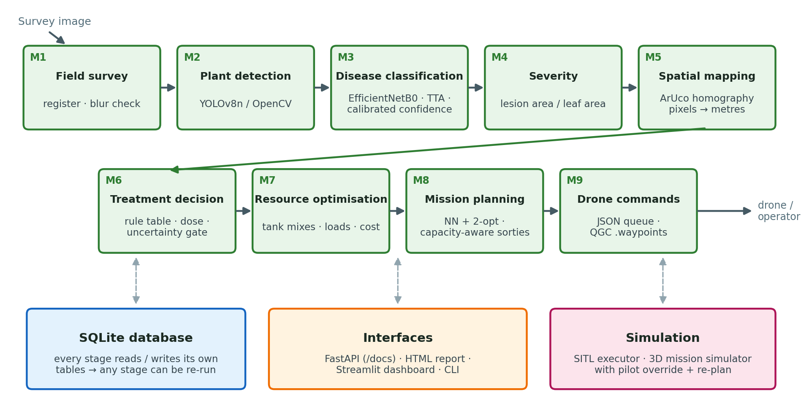

A survey (one or more images of a field) flows through nine modules. Each module reads its inputs from SQLite and writes its outputs back, so the stages are loosely coupled:

| Module | Purpose | Method | Main code | Writes table |
|---|---|---|---|---|
| M1 Field survey | Register a survey and check image quality | Image listing, variance-of-Laplacian blur check | `app/field_survey/service.py` | `surveys`, `survey_images` |
| M2 Plant detection | Find every plant and give it an ID | YOLOv8n (trained) or OpenCV vegetation segmentation; adaptive row ordering | `app/detection/` | `detections` |
| M3 Disease classification | Disease + calibrated confidence per plant | EfficientNetB0 transfer learning, flip-TTA, temperature scaling, Grad-CAM | `app/classification/` | `classifications` |
| M4 Severity | Fraction of leaf area that is diseased | OpenCV leaf and lesion segmentation | `app/severity/` | `plant_severity` |
| M5 Spatial mapping | Pixel → field metres | ArUco markers + homography | `app/spatial_mapping/` | `spatial_calibrations`, `plant_locations` |
| M6 Treatment decision | Action, dose and reason per plant | Ordered rule table from JSON | `app/decision/` | `treatment_decisions` |
| M7 Resource optimisation | Tank mixes, loads, cost | Group by treatment, capacity arithmetic | `app/resource_optimization/` | part of `mission_plans` |
| M8 Mission planning | Shortest capacity-aware route | Nearest neighbour + 2-opt, route-first/cluster-second | `app/mission_planner/` | `mission_plans` |
| M9 Drone integration | Executable mission | JSON command queue + QGroundControl waypoints; SITL executor | `app/drone_integration/`, `simulator/` | `drone_commands`, `execution_logs` |

### Technology stack

| Layer | Technology |
|---|---|
| Language | Python 3.11 (backend, ML); JavaScript ES modules (simulator front end) |
| Deep learning | TensorFlow 2.21 / Keras 3.15 (EfficientNetB0); Ultralytics YOLOv8 8.4 |
| Computer vision | OpenCV (ArUco, homography, segmentation, morphology) |
| Data / ML utilities | NumPy, pandas, scikit-learn (stratified splitting, metrics), SciPy, Matplotlib |
| API | FastAPI + Uvicorn, Pydantic request validation |
| Storage | SQLite (`database/smartspray.db`) |
| Interfaces | Streamlit dashboard, self-contained HTML report, Jupyter report notebook |
| 3D simulator | three.js r186 (bundled locally, no internet needed), WebGL |
| Drone formats | MAVLink mission file `QGC WPL 110` (QGroundControl / Mission Planner) |
| Testing | pytest (277 tests), headless Chromium (Playwright) for simulator run-throughs |

### Repository layout

```text
SmartSpray-main/
├── app/                         backend package (FastAPI app + all modules)
│   ├── main.py                  FastAPI app: routers, /pipeline/run, /reports
│   ├── pipeline.py              runs M1 → M9 for a survey (also a CLI)
│   ├── db.py                    SQLite connection + table creation
│   ├── reporting.py             self-contained HTML report
│   ├── field_survey/            M1
│   ├── detection/               M2  detector.py, identity_resolver.py, router.py
│   ├── classification/          M3  classifier.py, model_factory.py, explain.py, service.py
│   ├── severity/                M4  estimator.py, service.py, router.py
│   ├── spatial_mapping/         M5  calibration.py, mapper.py, router.py
│   ├── decision/                M6  rules_engine.py, service.py, database.py
│   ├── resource_optimization/   M7  grouping.py, router.py
│   ├── mission_planner/         M8  route_optimizer.py, service.py, router.py
│   ├── drone_integration/       M9  command_queue.py, router.py
│   └── simulation/              3D simulator backend: world.py, service.py, router.py
├── simulator/
│   ├── executor_simulator.py    software-in-the-loop executor for M9 commands
│   └── web/                     3D mission simulator page (index.html, js/, vendor/)
├── dashboard/streamlit_app.py   Streamlit dashboard (5 pages)
├── rules/                       dosage_rules.json, mission_config.json
├── models/
│   ├── classification/          best.keras, class_order.json, inference_config.json,
│   │                            split_manifest.json/.csv, eval/ (metrics, figures, logs)
│   ├── yolov8_plant_detector/   best.pt, eval/metrics.json
│   └── pretrained/              EfficientNetB0 ImageNet weights
├── data/
│   ├── datasets/                plantvillage_tomato/, plant_detection/
│   ├── images/<survey_id>/      survey images
│   └── outputs/<survey_id>/     report.html, gradcam/, mission/, logs
├── scripts/                     training, demo, inspection and housekeeping scripts
├── notebooks/                   executed Module 3 report notebook
├── docs/                        this document, MODULE3_REPORT.md, SIMULATOR.md, ...
├── tests/                       pytest suite
├── database/                    smartspray.db, schema.sql
└── requirements.txt, README.md
```

### Data flow and storage

Every module is a small service with three layers: a **pure algorithm** file (no database, easy to unit-test), a **service** file that loads inputs from SQLite, runs the algorithm and saves results, and a **router** file that exposes the service over HTTP. The pipeline (`app/pipeline.py`) calls the services in order, but each one can also be called alone. Because results are stored per `survey_id`, re-running a stage simply replaces that stage's rows.

### Coordinate frames

| Frame | Units | Origin and axes | Used by |
|---|---|---|---|
| Image | pixels | top-left corner, x right, y down | M2 boxes, M3/M4 crops |
| Field | metres | marker 0 (south-west corner), x east, y north | M5 output, M6–M8, simulator |
| GPS | degrees | WGS-84 latitude/longitude; field origin at `origin_lat`, `origin_lon` in `rules/mission_config.json` | M9 waypoint files |

M5 converts image → field with a homography. M9 converts field → GPS with a local flat-earth approximation: latitude = lat₀ + y / 111 320, longitude = lon₀ + x / (111 320 · cos lat₀).

## Datasets and data preparation

### PlantVillage tomato subset (Module 3)

The disease classifier is trained on four tomato classes from the public PlantVillage dataset: single leaves photographed on a plain background (256 × 256 px). The data lives in `data/datasets/plantvillage_tomato/<class>/`.

| Class | Raw files |
|---|---|
| early_blight | 800 |
| healthy | 1,273 |
| late_blight | 1,526 |
| septoria_leaf_spot | 1,417 |
| **Total** | **5,016** |

### De-duplication

Every file is hashed with SHA-256. Nine files were exact byte-for-byte duplicates of another file (four healthy, five late blight). They were removed **before** splitting, because a duplicate pair split across train and test would leak test images into training. After de-duplication: **5,007 unique images**. Unreadable files, label conflicts and non-image files were also checked for (none found).

### The 70 / 15 / 15 split

The split is made by `scripts/m3_train_classifier.py --stage split` with scikit-learn's `train_test_split` called twice, both with `stratify=labels` and `random_state=42`:

1. 70 % train vs 30 % hold-out.
2. Hold-out split 50 / 50 into validation and test.

| Split | early_blight | healthy | late_blight | septoria | Total |
|---|---|---|---|---|---|
| Train (70 %) | 560 | 888 | 1,064 | 992 | **3,504** |
| Validation (15 %) | 120 | 191 | 228 | 212 | **751** |
| Test (15 %) | 120 | 190 | 229 | 213 | **752** |

**Leakage checks** (all recorded in `models/classification/split_manifest.json`): path overlap and SHA-256 overlap between every pair of splits = 0; every unique image appears in exactly one split; the dropped duplicates are absent from all splits. The manifest lists every file with its split, label and hash (also as CSV), and its own SHA-256 is stored with the evaluation results so the exact split can be verified later.

**How each split is used.** Train: fitting weights, with augmentation. Validation: early stopping, learning-rate schedule, checkpoint selection, and the choice of inference settings (TTA, temperature). Test: evaluated **exactly once** after everything was frozen; a lock file (`models/classification/eval/TEST_EVALUATED.lock`) then stops any further training on the same split.

> Why the old numbers were replaced: the earlier notebook used an 80/20 train/validation split with no test set, and the model was selected on that same validation set. Its 98.4 % / 96.68 % figures were therefore not held-out results. The 97.34 % reported here is a single-use, held-out test result.

### Augmentation (training only)

Applied on the fly to training batches only, seeded with 42: random horizontal flip, random rotation ±20°, random translation ±15 %, random zoom ±15 %, random brightness ±20 %. Validation and test images are never augmented.

### Plant-detection dataset (Module 2)

LeafPest "Plant Detection" v1 (Roboflow, CC BY 4.0), YOLOv8 export, one class `Tomato-Plant`: 460 train, 57 validation and 29 test images of real greenhouse/field tomato plants. Stored in `data/datasets/plant_detection/`.

### Synthetic fields (demo and simulator)

There is no labelled drone imagery of a diseased tomato field with markers, so the end-to-end demo and the simulator use **synthetic fields** built from real photos:

- Every plant is a real PlantVillage photo taken **only from the test split**, so the classifier has never seen any of them in training or model selection.
- Plants are laid out in rows on a generated soil texture (furrows, noise, lighting gradient, sensor noise, slight perspective tilt).
- Disease appears in patches: the scripted demo field (10 m × 8 m, 7 rows × 9 plants = 63) has a late-blight hotspot (6 plants), an early-blight patch (7) and a septoria patch (6); other simulator fields use randomly grown patches (~9 % of plants per disease).
- Four ArUco markers (ids 0–3) sit at the corners.
- A `ground_truth.json` (demo) or the session state (simulator) records each plant's true label and position, so the system's output can be scored.

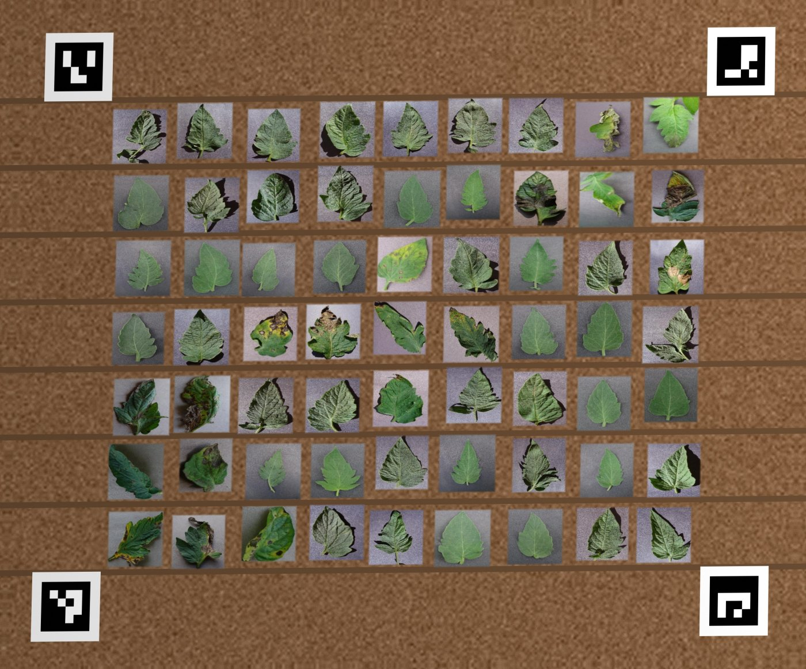

The synthetic field demonstrates and measures the pipeline; it is not a field trial (see Chapter 21).


## Module 1 — Field survey

**Purpose.** Register a survey (a folder of images of one field) and check that the images are usable before any analysis runs.

**Input.** Images in `data/images/<survey_id>/` (`.jpg`, `.jpeg`, `.png`) plus the crop name and the field size in metres.
**Output.** One row in `surveys` and one row per image in `survey_images`.

**How it works.**

1. The survey id is validated (non-empty, a plain folder name: no `/`, `\` or leading `.`, which prevents path traversal).
2. The folder is listed; a survey with no images is rejected; a survey id can only be registered once.
3. Each image is checked by `assess_image()`: it is loaded in greyscale and its **sharpness** is measured as the variance of the Laplacian (a second-derivative edge filter). Sharp images have strong edges and a high variance; blurred images have a low one. Images scoring below **100** are flagged `is_blurry`. Images OpenCV cannot decode are flagged unreadable.
4. The survey row stores the capture date, crop (default "Tomato"), field size string (e.g. `10m x 8m`), the number of images and the creation time.

```python
def assess_image(path: Path, blur_threshold: float = BLUR_THRESHOLD) -> dict:
    """Readability + sharpness check for one image (never raises)."""
    image = cv2.imread(str(path), cv2.IMREAD_GRAYSCALE)
    if image is None:
        return {"image_filename": path.name, "is_readable": False, ...}
    score = float(cv2.Laplacian(image, cv2.CV_64F).var())
    return {"image_filename": path.name, "is_readable": True,
            "is_blurry": score < blur_threshold, "blur_score": round(score, 2), ...}
```

| Item | Value |
|---|---|
| Code | `app/field_survey/service.py`, `app/field_survey/router.py` |
| Tables | `surveys` (survey_id, capture_date, crop, field_size, num_images, created_at); `survey_images` (survey_id, image_filename, width_px, height_px, blur_score, is_readable, is_blurry, checked_at) |
| API | `POST /survey/register` `{"survey_id", "crop", "field_width_m", "field_height_m"}` · `GET /survey/{survey_id}` |
| Tests | `tests/test_field_survey.py` (registration, duplicates, quality check, clean-up) |

## Module 2 — Plant detection

**Purpose.** Find every plant in each survey image, draw a bounding box around it, and give it a stable `plant_id` that all later modules use.

**Output.** Rows in `detections` (survey_id, image_filename, plant_id, bbox_x1, bbox_y1, bbox_x2, bbox_y2, confidence, model_version).

### Detector 1: YOLOv8n (trained model)

A YOLOv8-nano object detector, fine-tuned from COCO-pretrained weights on the LeafPest plant-detection dataset, is the default detector for real photos. YOLO divides the image into a grid and, in a single forward pass, predicts boxes and confidence scores for objects; detections below confidence 0.25 are discarded.

| Training setting | Value |
|---|---|
| Base weights | `yolov8n.pt` (COCO) |
| Dataset | LeafPest Plant Detection v1: 460 train / 57 validation / 29 test, one class |
| Image size / batch / epochs | 512 px / 8 / 30 |
| Optimiser / learning rate / seed | AdamW / 0.001 / 42 (deterministic) |
| Model selection | Ultralytics `best.pt` by validation fitness; test split evaluated once at the end |
| Script | `scripts/m2_train_detector.py` (writes `models/yolov8_plant_detector/best.pt` and `eval/metrics.json`) |

| Split | mAP50 | mAP50-95 | Precision | Recall |
|---|---|---|---|---|
| Validation (57 images) | 0.952 | 0.748 | 0.911 | 0.956 |
| **Test (29 images)** | **0.925** | **0.805** | **0.997** | **0.912** |

mAP50 is the mean average precision when a predicted box counts as correct if it overlaps the true box by at least 50 % (intersection over union ≥ 0.5); mAP50-95 averages the same measure over stricter overlaps from 0.50 to 0.95.

### Detector 2: OpenCV vegetation fallback

A training-free detector (`ClassicalPlantDetector`) used when YOLO weights are unavailable and for the synthetic fields (where YOLO, trained on real photos, is not appropriate):

1. **Vegetation mask.** A pixel is vegetation if its HSV colour lies in hue 22–95, saturation ≥ 25, value ≥ 30 (green to yellow-green) **or** its excess-green index ExG = 2G − R − B exceeds 20.
2. **Clean-up.** Morphological opening with a small elliptical kernel (k = 1 % of the shorter image side, odd) removes speckle; closing with a 2k kernel fills lesions and gaps inside a plant; a second opening with the 2k kernel cuts thin "necks" between touching neighbours.
3. **Components.** Each connected blob between 0.04 % and 25 % of the image area is one plant.
4. **Boxes.** The blob's box is padded by 8 % and made square, so Module 3 does not distort the leaf when it resizes the crop to 224 × 224. Confidence = 0.5 + 0.5 × (blob area / box area).

`kernel_frac` (default 0.01) can be lowered when plants are small relative to the frame; the simulator's whole-field overview uses 0.004.

### Plant IDs (identity resolver)

Detectors return boxes in arbitrary order, so `assign_plant_ids()` sorts them spatially before numbering: boxes are sorted by their vertical centre; a box joins the current row if its centre is within **half the median box height** of the row's mean y; each row is then sorted left to right. Plant #1 is therefore always the top-left plant, and re-running the same image gives the same IDs. (The original version used a fixed 60-pixel band, which split tilted or high-resolution rows.) IDs continue across images of the same survey so every plant id is unique per survey.

| Item | Value |
|---|---|
| Code | `app/detection/detector.py` (both detectors, `get_detector(mode)`), `app/detection/identity_resolver.py`, `app/detection/router.py` |
| Detector modes | `yolo` (default), `auto` (YOLO if weights exist, else fallback), `classical`; or environment variable `SMARTSPRAY_DETECTOR` |
| API | `POST /detect` `{"survey_id", "detector"}` · `GET /detect/health` |
| Tests | `tests/test_detection.py` (28 tests: boxes, IDs, tilted rows, fallback, DB, API) |

## Module 3 — Disease classification

Module 3 is the core of the system. It decides, for every plant, which of four classes it belongs to, how confident that decision is, whether the confidence is high enough to act on, and which parts of the image drove the decision.

### Classes

The class order is fixed in `models/classification/class_order.json` and checked at start-up against the code (`app/classification/prediction.py`): **0 early_blight, 1 healthy, 2 late_blight, 3 septoria_leaf_spot**. If the two ever disagree the classifier refuses to load, so predictions can never be silently mislabelled.

### Model architecture

Transfer learning on **EfficientNetB0**, a convolutional network designed by compound scaling of depth, width and resolution (Tan & Le, 2019). It gives ImageNet-level features with only about 4 million parameters, so it runs comfortably on a laptop CPU or an edge device.

| Layer | Output shape | Parameters | Notes |
|---|---|---|---|
| `image` (input) | 224 × 224 × 3 | 0 | RGB, values 0–255 |
| `efficientnetb0` (backbone) | 7 × 7 × 1280 | 4,049,571 | 237 layers; ImageNet weights; includes its own rescaling and normalisation layers |
| `gap` GlobalAveragePooling2D | 1280 | 0 | one value per feature map |
| `dropout_head_1` | 1280 | 0 | rate 0.3 |
| `dense_256` Dense, ReLU | 256 | 327,936 | |
| `dropout_head_2` | 256 | 0 | rate 0.2 |
| `predictions` Dense, softmax | 4 | 1,028 | class probabilities |
| **Total** | | **4,378,535** | |

```python
inputs = keras.Input(shape=(224, 224, 3), name="image")
x = base(inputs, training=False)           # BatchNorm stays in inference mode
x = layers.GlobalAveragePooling2D(name="gap")(x)
x = layers.Dropout(0.3, name="dropout_head_1")(x)
x = layers.Dense(256, activation="relu", name="dense_256")(x)
x = layers.Dropout(0.2, name="dropout_head_2")(x)
outputs = layers.Dense(4, activation="softmax", name="predictions")(x)
```
(`app/classification/model_factory.py`)

### Training procedure

Training is done by `scripts/m3_train_classifier.py` in three phases. Loss: sparse categorical cross-entropy; optimiser: Adam; batch size 32; seed 42. Early stopping (patience 5; phase 3: 3) watches validation accuracy; ReduceLROnPlateau multiplies the learning rate by 0.5 (phase 3: 0.3) when validation loss stops improving (patience 3; phase 3: 2). A custom `ValidationSelector` callback saves the best checkpoint seen across **all** phases, judged on validation accuracy with ties broken by validation loss; the test split is not even loaded during training.

| Phase | What is trained | Learning rate | Max epochs | Epochs run | Time (2-core CPU) | Best validation accuracy |
|---|---|---|---|---|---|---|
| 1 | Head only (backbone frozen): 328,964 trainable parameters | 1e-3 | 20 | 20 | 34.4 min | 0.9667 (epoch 18) |
| 2 | Top 30 backbone layers + head; BatchNorm kept frozen (10 weighted layers, 1,812,324 trainable) | 1e-5 | 10 | 10 | 17.8 min | 0.9747 |
| 3 | Blocks 5–7 + top (from `block5a_expand_conv`, 118 layers; 41 weighted layers, 3,994,028 trainable); accepted only if validation improves | 1e-4 | 8 | 4 | 9.6 min | **0.9800** (epoch 1) |

Why BatchNorm stays frozen: with small batches, updating BatchNorm statistics during fine-tuning destroys the ImageNet statistics and hurts accuracy; keeping them frozen is standard Keras transfer-learning practice.


### Model selection (validation only)

After all phases, the checkpoint with the **highest validation accuracy** (ties broken by the lowest validation loss) is selected: phase 3, epoch 1 — validation accuracy 0.9800, validation loss 0.0609. The test split is never used to choose anything.

### Inference settings chosen on validation

Two inference options were evaluated on the validation split and kept only because they helped there:

- **Flip test-time augmentation (TTA).** The model also sees the mirrored image and the two softmax outputs are averaged. Validation accuracy 0.9800 → 0.9814, validation negative log-likelihood (NLL) 0.0609 → 0.0574. **Kept.**
- **Temperature scaling** (Guo et al., 2017). Neural networks are often over- or under-confident. A single scalar T is fitted on the validation set to minimise NLL, and probabilities are re-scaled as p_cal = softmax(log p / T). Fitted **T = 0.9010** (validation NLL 0.05742 → 0.05685; expected calibration error 0.0091 → 0.0082). T < 1 means the raw model was slightly *under*-confident. Temperature scaling never changes which class wins; it only makes the confidence number trustworthy, which matters because the decision engine acts on that number.

Both settings are stored in `models/classification/inference_config.json` and loaded automatically by the backend.

### Test-set evaluation (run once)

| Metric | Value |
|---|---|
| Test images | 752 (never used in training or selection) |
| Correct / incorrect | 732 / 20 |
| **Accuracy** | **0.9734** |
| Test loss | 0.0546 |
| Macro precision / recall / **F1** | 0.9683 / 0.9682 / **0.9681** |
| Weighted F1 | 0.9733 |

| Class | Precision | Recall | F1 | Support |
|---|---|---|---|---|
| early_blight | 0.924 | 0.917 | 0.921 | 120 |
| healthy | 0.990 | 1.000 | 0.995 | 190 |
| late_blight | 0.995 | 0.961 | 0.978 | 229 |
| septoria_leaf_spot | 0.964 | 0.995 | 0.979 | 213 |

**Confusion matrix** (rows = true class, columns = predicted):

| True \ Predicted | early_blight | healthy | late_blight | septoria |
|---|---|---|---|---|
| early_blight | **110** | 1 | 1 | 8 |
| healthy | 0 | **190** | 0 | 0 |
| late_blight | 8 | 1 | **220** | 0 |
| septoria | 1 | 0 | 0 | **212** |


**Production mode** (flip-TTA + temperature, settings frozen from validation): accuracy **0.9787**; expected calibration error 0.0150 → **0.0107**; 742 of 752 plants (98.7 %) have confidence ≥ 0.60 and **98.65 %** of those are correct; the other 10 are flagged uncertain (6 of the 10 were wrong, so the gate catches most errors).


**Error analysis.** Most errors are between the two "brown lesion" diseases: 8 early-blight leaves predicted as septoria and 8 late-blight leaves predicted as early blight. These diseases look alike at early stages, and early blight is the smallest class (800 raw images). Healthy leaves are almost never confused with disease (recall 1.000), which is what protects healthy plants from being sprayed.

### How a plant is classified inside the backend

This section follows one plant through the actual code.

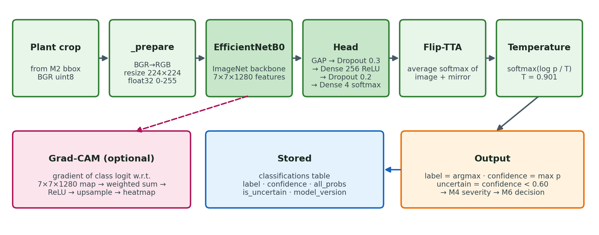

**1. Request.** The API call `POST /classify {"survey_id": "demo_survey_001"}` (or the pipeline, or the simulator) calls `classify_survey(survey_id)` in `app/classification/service.py`.

**2. Fetch detections.** The service opens SQLite, ensures the tables exist, and reads every row of `detections` for the survey (written by Module 2). If there are none it stops with "Run Module 2 first". Old classification rows for the survey are deleted so a re-run does not create duplicates.

**3. Load the model once.** `get_classifier()` returns a **singleton** `DiseaseClassifier`: the first call loads `models/classification/best.keras`, validates `class_order.json` against the code, and reads `inference_config.json` (T = 0.901, TTA on, threshold 0.60). Later calls reuse the loaded model.

**4. Crop.** For each detection, the original survey image is loaded with OpenCV and the plant's bounding box is cropped (coordinates are clamped to the image; empty boxes are rejected).

**5. Pre-process** (`DiseaseClassifier._prepare`): convert OpenCV's BGR to RGB, resize to 224 × 224, convert to float32 in the 0–255 range. Pixel scaling and ImageNet normalisation are done *inside* the model by EfficientNetB0's own layers, so no manual normalisation is needed (and none can be forgotten).

**6. Forward pass with TTA** (`_forward`): the crop and its mirror image go through the network **in one batch** using a compiled `tf.function` (identical numbers to `model.predict()`, about 3× faster for single crops). The two softmax vectors are averaged.

```python
def _forward(self, batch):
    if isinstance(self._model, tf.keras.Model):
        if self._compiled is None:
            self._compiled = tf.function(lambda x: model(x, training=False),
                                         reduce_retracing=True)
        n = len(batch)
        x = np.concatenate([batch, batch[:, :, ::-1, :]]) if self._tta else batch
        out = np.asarray(self._compiled(tf.convert_to_tensor(x, tf.float32)))
        return (out[:n] + out[n:]) / 2.0 if self._tta else out
```

**7. Calibrate.** The averaged probabilities are re-scaled with the temperature:

```python
def _softmax_with_temperature(probs, temperature):
    z = np.log(np.clip(probs, 1e-12, 1.0)) / temperature
    z = z - z.max(axis=-1, keepdims=True)
    e = np.exp(z)
    return e / e.sum(axis=-1, keepdims=True)
```

**8. Decide.** label = class with the highest calibrated probability; confidence = that probability; `uncertain = confidence < 0.60`. The result is a dictionary:

```json
{"label": "late_blight", "confidence": 0.9999,
 "all_probs": {"early_blight": 0.0, "healthy": 0.0001,
               "late_blight": 0.9999, "septoria_leaf_spot": 0.0},
 "raw_confidence": 0.9998, "uncertain": false}
```

**9. Store.** A `ClassificationResult` is saved to the `classifications` table (survey_id, image_filename, plant_id, bbox, label, confidence, all_probs_json, model_version, is_uncertain, created_at).

**10. Explain (optional).** With `save_gradcam=true`, a Grad-CAM overlay is written to `data/outputs/<survey_id>/gradcam/plant_###.jpg`.

**11. Hand-off.** Module 4 reads the label to choose the lesion profile; Module 6 reads label, confidence and `is_uncertain` to decide the action. An uncertain plant is always sent to manual inspection, never sprayed automatically.

#### Worked example (terminal)

`scripts/inspect_classifier.py` runs the exact same code path on one image and prints every intermediate value. Run it during the review:

```bash
python scripts/inspect_classifier.py --label late_blight --seed 3
python scripts/inspect_classifier.py path/to/any_leaf.jpg
python scripts/inspect_classifier.py --survey demo_survey_001 --plant 12
```

Output (abridged; class names shortened) for a test-split late-blight photo:

```text
STEP 1 · Load the trained model
model file      : models/classification/best.keras
SHA-256         : 499ceca37640900d7d2771dbac1c5f55cf30796875a56b6f4ec584918d92614e
model version   : efficientnetb0-tomato-disease-v2-701515
parameters      : 4,378,535
layers          : image -> efficientnetb0 -> gap -> dropout -> dense_256 -> dropout -> predictions
inference config: temperature T = 0.9010, flip-TTA = True, uncertainty threshold = 0.6
STEP 3 · Pre-processing
BGR -> RGB, resize to 224x224, float32 -> (224, 224, 3), range 1..221
STEP 4 · Forward pass
original image  : early 0.0000  healthy 0.0002  late 0.9998  septoria 0.0000
mirrored image  : early 0.0000  healthy 0.0001  late 0.9999  septoria 0.0000
averaged (TTA)  : early 0.0000  healthy 0.0002  late 0.9998  septoria 0.0000
STEP 5 · Confidence calibration   p_cal = softmax(log(p) / T)
calibrated      : early 0.0000  healthy 0.0001  late 0.9999  septoria 0.0000
STEP 6 · Prediction
=> late_blight at 100.0% : confident (>= threshold)
=> CORRECT (true label late_blight)
STEP 7 · Severity (Module 4)   score 0.000 -> low (valid=False: leaf fill < 0.20)
STEP 8 · Treatment decision (Module 6)
action SPRAY | dose 10.0 mL | treatment late_blight_fungicide
reason: Severity could not be measured; late_blight is treated by default. ...
STEP 9 · Grad-CAM saved: data/outputs/inspect/gradcam_<name>.jpg
```

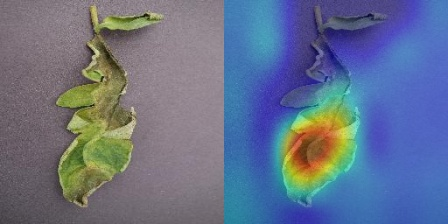

### Grad-CAM explanations

Grad-CAM (Selvaraju et al., 2017) shows which regions of the image pushed the score for the predicted class up:

1. Run the backbone to get the last convolutional feature map A (7 × 7 × 1280).
2. Run the head and take the class **logit** (pre-softmax score) yᶜ. The logit is used instead of the probability so that very confident predictions still give useful gradients.
3. Compute the gradient ∂yᶜ/∂A with `tf.GradientTape`.
4. Weight each of the 1280 feature maps by the mean of its gradient: αₖ = mean(∂yᶜ/∂Aₖ).
5. Heatmap = ReLU(Σₖ αₖ Aₖ), normalised to 0–1 and upsampled to the crop size, then blended over the image with a JET colour map.

The computation is compiled once per model with `tf.function` (≈ 50 ms instead of ≈ 730 ms on a 2-core CPU) so the simulator can explain every plant as the drone photographs it. Code: `app/classification/explain.py`.


Grad-CAM also exposed the system's main limitation: on six real greenhouse photos, the classifier labelled most plants as diseased and the heatmaps showed it looking at yellow irrigation pipes and background rather than leaves (see Chapter 21).

### Reproducibility and safe promotion

| Record | Where |
|---|---|
| Split manifest (every file, split, label, SHA-256) | `models/classification/split_manifest.json` / `.csv` |
| Training history per phase, hyper-parameters, environment (Python 3.11.15, TensorFlow 2.21.0, Keras 3.15.0) | `models/classification/eval/training_history.json`, `history_phase*.csv`, `run_log.txt` |
| Test metrics, per-class report, confusion matrix, all predictions, misclassified list | `models/classification/eval/metrics.json`, `classification_report.*`, `confusion_matrix.*`, `test_predictions.csv`, `misclassified.csv` |
| Test-set lock | `models/classification/eval/TEST_EVALUATED.lock` |
| Promotion record: old model SHA-256 `4022becc…` backed up as `best.keras.bak-20260916-061314`; new model SHA-256 `499ceca3…` verified (output shape [None, 4], probabilities sum to 1) before copying | `models/classification/eval/promotion_record.json` |
| Executed report notebook | `notebooks/m3_classification_701515_report.ipynb` |
| Written report | `docs/MODULE3_REPORT.md` |

The ImageNet backbone weights could not be downloaded from Google's server in the build environment, so they were recovered from the frozen (never-trained) backbone of the original model; all its layers were verified as non-trainable with ImageNet normalisation values, so the starting point is the standard ImageNet initialisation.

| Item | Value |
|---|---|
| Code | `app/classification/classifier.py` (inference), `model_factory.py` (architecture), `explain.py` (Grad-CAM), `prediction.py` (data contracts, class order, threshold), `service.py` (survey workflow), `database.py`, `router.py` |
| Model files | `models/classification/best.keras`, `class_order.json`, `inference_config.json` |
| API | `POST /classify` `{"survey_id", "save_gradcam"}` · `GET /classify/results/{survey_id}` · `GET /classify/health` |
| Tests | `tests/test_classification.py` (36 tests: data contracts, class-order guard, calibration, TTA, uncertainty, DB, API) |


## Module 4 — Severity estimation

**Purpose.** Estimate how much of a diseased plant's leaf area shows symptoms, so the dose can follow the severity.

**Method.** A deterministic OpenCV estimator (`app/severity/estimator.py`), not a trained model. For each plant crop and its Module 3 label:

1. **Leaf segmentation.** Convert to HSV and keep green / yellow-green tissue (H 25–90, S ≥ 40, V ≥ 40); close small holes (7 × 7 kernel); keep the largest connected component as the leaf; expand it with a large elliptical closing (21 × 21) so that brown diseased tissue surrounded by green is counted as leaf. The pixel count is `leaf_px`.
2. **Lesion segmentation** with a disease-specific profile (table below), restricted to the leaf mask; small components are discarded. The pixel count is `lesion_px`.
3. **Score** = lesion_px / leaf_px (0–1).
4. **Category** from fixed bands: **< 0.20 low, 0.20–0.50 medium, > 0.50 high** (design parameters from the original specification, not agronomic thresholds).
5. **Validity.** Healthy plants get score 0 and category low. The estimate is marked `is_valid = False` (score 0) for an empty crop or one without three colour channels, a crop smaller than 16 × 16 px, no leaf tissue found, or a leaf fill ratio below 0.20 of the box. Module 6 then applies its invalid-severity policy (late blight is still treated; other diseases go to inspection).

Lesion profiles used in step 2:

| Disease | Lesion colour rule (OpenCV 8-bit HSV / Lab units) | Clean-up | Component filter |
|---|---|---|---|
| Early blight | HSV H 10–40, S ≥ 40, V ≥ 40 **and** Lab L* ≤ 110, a* ≥ 115 (dark reddish-brown rings) | open 3, close 5 | ≥ 9 px |
| Late blight | HSV V ≤ 90 (dark, water-soaked tissue) | close 11 | ≥ 20 px |
| Septoria | HSV H 10–40, V ≥ 90 **and** Lab L* ≥ 25, a* ≥ 90 (pale spots) | open 2, close 5 | 12 px up to 20 % of the leaf |

| Item | Value |
|---|---|
| Code | `app/severity/estimator.py` (algorithm), `service.py` (crops from survey + labels from M3), `database.py`, `router.py` |
| Table | `plant_severity` (survey_id, plant_id, image_filename, disease_label, severity_score, severity_category, leaf_px, lesion_px, is_valid, model_version) |
| API | `POST /severity` `{"survey_id"}` · `GET /severity/health` |
| Tests | `tests/test_severity.py` (39 tests: bands, profiles, invalid cases, DB) |
| Limitation | No labelled severity ground truth exists; the score is a heuristic and is reported as such. |

## Module 5 — Spatial mapping

**Purpose.** Convert every plant's pixel position into field coordinates in metres, so the drone knows where to fly.

**Marker layout.** Four ArUco markers (dictionary `DICT_4X4_50`) lie flat at the field corners: id 0 at (0, 0) — the origin, id 1 at (W, 0), id 2 at (W, H), id 3 at (0, H), where W × H is the field size in metres. ArUco markers are square binary patterns with error-correcting codes that OpenCV can detect and identify robustly even at low resolution.

**Calibration** (`app/spatial_mapping/calibration.py`):

1. Detect markers with `cv2.aruco.ArucoDetector` (OpenCV ≥ 5 API). The correspondence point for each marker is its **centre**, the mean of its four detected corners.
2. Match each detected id to its known field corner. At least 4 markers are required.
3. Solve the **homography** H, a 3 × 3 projective transform from image to field: with exactly 4 points the solution is exact (`cv2.findHomography(src, dst, 0)`); with more points RANSAC is used (5 px inlier threshold).
4. Compute the mean **reprojection error** in pixels; the calibration is valid only if it is ≤ 25 px.
5. Store the calibration (homography as JSON) in `spatial_calibrations`.

**Mapping** (`app/spatial_mapping/mapper.py`): for each detection take the bounding-box centre (u, v) and apply

  [X, Y, W]ᵀ = H · [u, v, 1]ᵀ,  x = X / W,  y = Y / W

which gives the plant position (x, y) in metres. A homography also corrects the mild perspective tilt of an oblique drone photo.

**No guessing.** If a survey has no valid calibration, plants are stored with `mapping_mode = "uncalibrated"` and NULL coordinates. Module 8 then refuses to plan a mission (`blocked_uncalibrated`) instead of inventing positions. The pipeline first tries **auto-calibration**: it looks for the four markers in the survey's own images.

| Item | Value |
|---|---|
| Tables | `spatial_calibrations` (calibration_id, survey_id, image_filename, field_width_m, field_height_m, aruco_dict, marker_count, homography_json, reprojection_error, is_valid); `plant_locations` (survey_id, plant_id, bbox_cx_px, bbox_cy_px, field_x_m, field_y_m, is_mapped, calibration_id, mapping_mode, model_version) |
| API | `POST /spatial/calibrate` `{"survey_id", "image_filename", "field_width_m", "field_height_m"}` · `POST /spatial/map` `{"survey_id"}` · `GET /spatial/locations/{survey_id}` · `GET /spatial/health` |
| Result | Demo field: mean position error **5.5 cm**, maximum 25 cm, against ground truth |
| Tests | `tests/test_spatial_mapping.py` (104 tests: homography maths, marker layouts, invalid inputs, DB, API) |
| Upgrade path | Replace ArUco with RTK-GPS geotags; only this module changes |

## Module 6 — Treatment decision engine

**Purpose.** Turn the evidence for each plant (disease and confidence from M3, severity from M4, position from M5) into an explicit, auditable decision: **action, dose, treatment and a written reason.**

**Actions:** `spray` · `no_spray` · `monitor` (mild; re-survey before treating) · `inspect` (a person must look) · `hold` (would spray, but it was sprayed recently).

**Decision order** (`app/decision/rules_engine.py`, first matching rule wins):

1. No classification → **inspect**.
2. Unknown label → **inspect**.
3. Healthy → **no_spray**.
4. Confidence < 0.60 (or flagged uncertain by M3) → **inspect**. *The system never sprays on a guess.*
5. Severity invalid or missing → invalid-severity policy: late blight → spray with the medium dose (it spreads too fast to wait); other diseases → **inspect**.
6. Disease × severity rule from the table below.
7. Re-treatment check: if the action is spray and a mapped spray decision from **another** survey within the last **7 days** lies within **0.35 m** of this plant → **hold**. (Simulated missions, ids starting with `sim_`, are separate synthetic fields and are ignored.)

**Rule table** (`rules/dosage_rules.json`, version `dosage-rules-v1`; doses in mL of prepared mix per plant):

| Disease | Low (< 20 %) | Medium (20–50 %) | High (> 50 %) | Treatment |
|---|---|---|---|---|
| Healthy | no spray | no spray | no spray | — |
| Early blight | monitor | spray 5 mL | spray 9 mL | protectant fungicide |
| Late blight | spray 10 mL | spray 10 mL | spray 10 mL | late-blight fungicide |
| Septoria leaf spot | monitor | spray 6 mL | spray 8 mL | protectant fungicide |

Blanket baseline: 10 mL on every plant. Prices (indicative): protectant mix ₹60/L, late-blight mix ₹95/L. Because the rules live in a JSON file, an agronomist can audit and change them without touching code; the file is validated at load time (every disease needs all three severity levels, valid actions, non-negative doses, and a treatment for every spray).

Every decision carries its reason, for example: *"Early blight 20–50% leaf area — standard protectant dose. (measured severity 41%)"* or *"Model confidence 0.44 < 0.60 for 'late_blight' — flagged uncertain, no automatic spray."*

**Savings summary** (`summarise_decisions`): chemical used vs blanket baseline (mL and %), cost vs blanket (blanket uses the most expensive programme on every plant, because a farmer who cannot see which disease is where sprays a broad programme), counts per action and per label.

| Item | Value |
|---|---|
| Table | `treatment_decisions` (plant_id, disease_label, confidence, is_uncertain, severity_score, severity_category, severity_valid, field_x_m, field_y_m, is_mapped, action, dosage_ml, treatment, reason, rules_version, decided_at) |
| API | `POST /decisions/generate` `{"survey_id"}` · `GET /decisions/{survey_id}` · `GET /decisions/rules/current` |
| Demo result | 14 of 63 plants sprayed, 4 monitored, 1 inspected, 44 left alone; 112 mL vs 630 mL (**82.2 % less**); ₹8.82 vs ₹59.85 |
| Tests | `tests/test_decision.py` (19 tests: every branch of the decision order, rule validation, summary) |

## Module 7 — Resource optimisation

**Purpose.** Work out what has to be mixed and loaded.

1. Group spray targets by treatment (largest programme first). Different mixes cannot share a tank.
2. For each programme: mix needed = Σ doses; mix to prepare = needed × (1 + 5 % reserve), rounded up; minimum tank loads = ⌈needed / usable capacity⌉; estimated cost.
3. Usable tank capacity = 250 mL × (1 − 5 % reserve) = 237.5 mL.

**Mission configuration** (`rules/mission_config.json`, placeholders for a small spot-spraying drone):

| Parameter | Value | Parameter | Value |
|---|---|---|---|
| Tank capacity | 250 mL | Cruise speed | 3.0 m/s |
| Tank reserve | 5 % | Spray flow | 5.0 mL/s |
| Refill time | 60 s | Take-off + landing time | 20 s |
| Cruise altitude | 2.5 m | Spray swath (blanket baseline) | 1.0 m |
| Battery | 90 Wh | Cruise / hover power | 180 W / 160 W |
| Depot (refill point) | field (0, 0) by default | GPS origin | 12.8406 N, 80.1534 E |

| Item | Value |
|---|---|
| Code | `app/resource_optimization/grouping.py`, `router.py` |
| API | `GET /resources/{survey_id}` · `GET /resources/config` |
| Tests | `tests/test_resource_optimization.py` |

## Module 8 — Mission planning

**Purpose.** Find the shortest flyable route over the plants that need spraying, starting and ending at the depot, without exceeding the tank.

**Algorithms** (`app/mission_planner/route_optimizer.py`, pure functions):

1. **Nearest neighbour** construction: from the depot, always fly to the closest unvisited target.
2. **2-opt** improvement (Croes, 1958): repeatedly reverse a segment of the tour whenever that shortens it (replace edges (a, b) and (c, d) by (a, c) and (b, d) if dist(a, c) + dist(b, d) < dist(a, b) + dist(c, d)), until no improvement remains.
3. **Capacity-aware routing** (a small capacitated vehicle-routing heuristic, "route first, cluster second"): build one optimised giant tour; try every rotation of it in both directions (plus the plant-id order as a baseline candidate); cut each candidate into consecutive tank-sized sorties; 2-opt every sortie; keep the candidate with the smallest total distance. Because the baseline is a candidate, the result is never worse than visiting plants in id order.
4. **Lawn-mower baseline**: the length of a back-and-forth pass covering the whole field with the spray swath (1 m), from and back to the depot. A 5 % tolerance avoids an extra pass when the measured field is a few centimetres taller than a whole number of swaths.
5. **Re-planning from any position** (used by the simulator after a manual override): serve as many targets as the remaining tank allows on an open path from the drone's position (nearest neighbour, then 2-opt with a fixed start and end at the depot), then plan the rest as normal sorties from the depot.

For 10–100 targets these run in milliseconds and are typically within a few percent of optimal, with no external solver.

**Metrics** for the plan and the blanket baseline:

- Flight time = distance / speed + Σ(dose / flow) + sorties × take-off/landing time + (sorties − 1) × refill time.
- Energy = (distance / speed) × cruise power + spray time × hover power; battery % = energy / 90 Wh.
- Blanket flight time uses the lawn-mower length and continuous spraying (no extra hover).

**Status:** `ready`, `ready_partial` (some targets unmapped, left out), `no_targets`, or `blocked_uncalibrated` (targets exist but none has a position — no savings are claimed).

| Item | Value |
|---|---|
| Code | `route_optimizer.py` (algorithms), `service.py` (build + store plan), `router.py` |
| Table | `mission_plans` (survey_id, status, plan_json, created_at) |
| API | `POST /mission/plan` `{"survey_id", "tank_capacity_ml"?, "cruise_speed_mps"?, "spray_flow_ml_per_s"?}` · `GET /mission/{survey_id}` |
| Demo result | **38.4 m** in 2 sorties vs **95.0 m** lawn-mower (59.6 % shorter); 16.8 % shorter than plant-id order |
| Tests | `tests/test_mission_planner.py`, plus re-planning tests in `tests/test_simulation.py` |

## Module 9 — Drone integration

**Purpose.** Turn the plan into commands a drone or executor can run, in a standard format.

**Command queue** (`app/drone_integration/command_queue.py`): for every sortie, in order: `load_tank` (treatment, volume) → `takeoff` (cruise altitude) → one `spray` per plant (location, dose, treatment, spray seconds, disease, severity) → `return_to_depot` → `land`. Stored in `drone_commands` with a status per command, and written to `data/outputs/<survey_id>/mission/drone_commands.json`.

**QGroundControl / Mission Planner export.** Each sortie is written as a `QGC WPL 110` text file (`sortie_##_<treatment>.waypoints`), one MAVLink mission item per line: index, current, frame (3 = global, altitude relative to home), command, four parameters, latitude, longitude, altitude, autocontinue.

| MAVLink command | Id | Used for |
|---|---|---|
| `MAV_CMD_NAV_WAYPOINT` | 16 | home, fly to plant, and hover (param 1 = spray seconds) |
| `MAV_CMD_NAV_TAKEOFF` | 22 | climb to cruise altitude |
| `MAV_CMD_DO_SPRAYER` | 216 | sprayer on (param 1 = 1) / off (param 1 = 0) |
| `MAV_CMD_NAV_RETURN_TO_LAUNCH` | 20 | return home at the end of the sortie |

```text
QGC WPL 110
0  1  0  16   0.00  0  0  0  12.84060000  80.15340000  0.00  1    home
1  0  3  22   0.00  0  0  0  12.84060000  80.15340000  2.50  1    take off to 2.5 m
2  0  3  16   0.00  0  0  0  12.84060888  80.15340998  2.50  1    fly to plant
3  0  3  216  1.00  0  0  0  0.00000000   0.00000000   0.00  1    sprayer ON
4  0  3  16   1.00  0  0  0  12.84060888  80.15340998  2.50  1    hover 1.0 s
5  0  3  216  0.00  0  0  0  0.00000000   0.00000000   0.00  1    sprayer OFF
```

Field metres are converted to GPS with lat = lat₀ + y / 111 320 and lon = lon₀ + x / (111 320 · cos lat₀).

**Software-in-the-loop executor** (`simulator/executor_simulator.py`) "flies" the queue: point-to-point flight at cruise speed with seeded GNSS noise (σ = 0.05 m), hover for dose / flow seconds while spraying, tank level and energy tracking, and safety checks (tank loaded only at the depot, tank never negative, spray point inside the field, battery reserve of 20 % respected). Every step is written to `execution_logs`; the summary goes to `mission/simulation_log.json`. Demo result: 135 s flight, 38.4 m, 3.8 % battery, mean spray placement error 5 cm, no violations.

| Item | Value |
|---|---|
| API | `POST /drone/commands/generate` `{"survey_id"}` · `GET /drone/commands/{survey_id}` · `GET /drone/mission/{survey_id}/{sortie}.waypoints` · `POST /drone/simulate` `{"survey_id", "gnss_noise_m", "seed"}` |
| CLI | `python -m simulator.executor_simulator <survey_id> --noise 0.05 --seed 7` |
| Tests | `tests/test_drone_integration.py` |


## Pipeline orchestration and storage

### The pipeline

`app/pipeline.py` runs all stages for a registered survey, in order, and returns one result dictionary with a status per stage:

| Stage | Call | Skips / stops when |
|---|---|---|
| 1 Survey | read `surveys` row | survey not registered → error |
| 2 Detection | `get_detector(mode).detect()` per image → `resolve_survey_detections()` → save | no images |
| 3 Classification | `classify_survey(survey_id, save_gradcam)` | no detections |
| 4 Severity | `estimate_survey()` → save each result | no classifications |
| 5 Mapping | auto-calibrate from the survey's own images if needed → `map_survey()` | — (uncalibrated plants get NULL positions) |
| 6 Decisions | `generate_decisions()` | no classifications |
| 7 + 8 Resources + route | `plan_mission()` | no decisions |
| 9 Commands | `generate_commands()`; optionally the SITL executor | plan not flyable |
| Report | `write_survey_report()` → `data/outputs/<id>/report.html` | optional |

A failing stage records its error and the remaining stages still run where they can, so one problem never hides the others. The same function backs `POST /pipeline/run` and the command line:

```bash
python -m app.pipeline demo_survey_001 --detector classical --gradcam --simulate --report
python -m app.pipeline demo_survey_001 --json          # print the full JSON result
```

### Database

One SQLite file, `database/smartspray.db` (path in `app/db.py`; 30-second lock timeout; the folder is created on first use; `init_db()` creates every table at API start-up). All tables are keyed by `survey_id` and, where relevant, `plant_id`.

| Table | Written by | Columns |
|---|---|---|
| `surveys` | M1 | survey_id, capture_date, crop, field_size, num_images, created_at |
| `survey_images` | M1 | survey_id, image_filename, width_px, height_px, blur_score, is_readable, is_blurry, checked_at |
| `detections` | M2 | detection_id, survey_id, image_filename, plant_id, bbox_x1, bbox_y1, bbox_x2, bbox_y2, confidence, model_version, created_at |
| `classifications` | M3 | classification_id, survey_id, image_filename, plant_id, bbox_x1..y2, label, confidence, all_probs_json, model_version, is_uncertain, created_at |
| `plant_severity` | M4 | severity_id, survey_id, plant_id, image_filename, disease_label, severity_score, severity_category, leaf_px, lesion_px, is_valid, model_version, estimated_at |
| `spatial_calibrations` | M5 | calibration_id, survey_id, image_filename, field_width_m, field_height_m, aruco_dict, marker_count, homography_json, reprojection_error, is_valid, calibrated_at |
| `plant_locations` | M5 | location_id, survey_id, plant_id, image_filename, bbox_cx_px, bbox_cy_px, field_x_m, field_y_m, is_mapped, calibration_id, mapping_mode, model_version, mapped_at |
| `treatment_decisions` | M6 | decision_id, survey_id, plant_id, image_filename, disease_label, confidence, is_uncertain, severity_score, severity_category, severity_valid, field_x_m, field_y_m, is_mapped, action, dosage_ml, treatment, reason, rules_version, decided_at |
| `mission_plans` | M7 + M8 | survey_id, status, plan_json, created_at |
| `drone_commands` | M9 | command_id, survey_id, seq, command_json, status, created_at, executed_at |
| `execution_logs` | SITL executor | log_id, survey_id, seq, event, detail_json, logged_at |

Module 6 gathers its evidence with one LEFT JOIN of detections, classifications, severity and locations, so a missing downstream result shows up as NULL instead of silently dropping the plant.

### Output files per survey

```text
data/outputs/<survey_id>/
├── report.html                      self-contained HTML report (images embedded)
├── pipeline_result.json             full result of every stage
├── demo_ground_truth_evaluation.json   (synthetic demo only) scores vs ground truth
├── gradcam/plant_###.jpg            Grad-CAM overlays
└── mission/
    ├── drone_commands.json          command queue
    ├── sortie_##_<treatment>.waypoints   QGroundControl / Mission Planner files
    └── simulation_log.json          SITL executor log
```

## Interfaces

### REST API (FastAPI)

Start with `uvicorn app.main:app --reload` and open `http://127.0.0.1:8000/docs` for interactive documentation where every endpoint can be tried in the browser.

| Method | Path | Module | Purpose |
|---|---|---|---|
| GET | `/`, `/health` | — | service info / health check |
| POST | `/survey/register` | M1 | register a survey (`survey_id`, `crop`, `field_width_m`, `field_height_m`) |
| GET | `/survey/{survey_id}` | M1 | survey record |
| POST | `/detect` | M2 | detect plants (`survey_id`, `detector`: yolo / auto / classical) |
| GET | `/detect/health` | M2 | detector status |
| POST | `/classify` | M3 | classify all detected plants (`survey_id`, `save_gradcam`) |
| GET | `/classify/results/{survey_id}` | M3 | stored classifications |
| GET | `/classify/health` | M3 | model version, temperature, TTA, threshold |
| POST | `/severity` | M4 | estimate severity for every classified plant |
| GET | `/severity/health` | M4 | estimator status |
| POST | `/spatial/calibrate` | M5 | calibrate from one image with the four markers |
| POST | `/spatial/map` | M5 | map every plant to metres |
| GET | `/spatial/locations/{survey_id}` | M5 | stored positions |
| GET | `/spatial/health` | M5 | mapping status |
| POST | `/decisions/generate` | M6 | decide every plant |
| GET | `/decisions/{survey_id}` · `/decisions/rules/current` | M6 | decisions · active rule table |
| GET | `/resources/{survey_id}` · `/resources/config` | M7 | tank mixes · mission configuration |
| POST | `/mission/plan` | M8 | plan the route (optional tank / speed / flow overrides) |
| GET | `/mission/{survey_id}` | M8 | stored plan |
| POST | `/drone/commands/generate` | M9 | command queue + waypoint files |
| GET | `/drone/commands/{survey_id}` | M9 | command queue |
| GET | `/drone/mission/{survey_id}/{sortie}.waypoints` | M9 | download a QGroundControl file |
| POST | `/drone/simulate` | M9 | run the SITL executor (`gnss_noise_m`, `seed`) |
| POST | `/pipeline/run` | all | run M1–M9 (`survey_id`, `detector`, `save_gradcam`, `simulate`, `write_report`) |
| GET | `/reports/{survey_id}` | — | the HTML report |
| GET | `/simulator/` | sim | 3D mission simulator page |
| POST / GET | `/sim/...` | sim | simulator steps (Chapter 16) |

Every request body is validated by Pydantic (wrong types return HTTP 422), unknown surveys return 404, missing prerequisites return 400 with a message naming the module to run first, and file-serving endpoints reject path traversal.

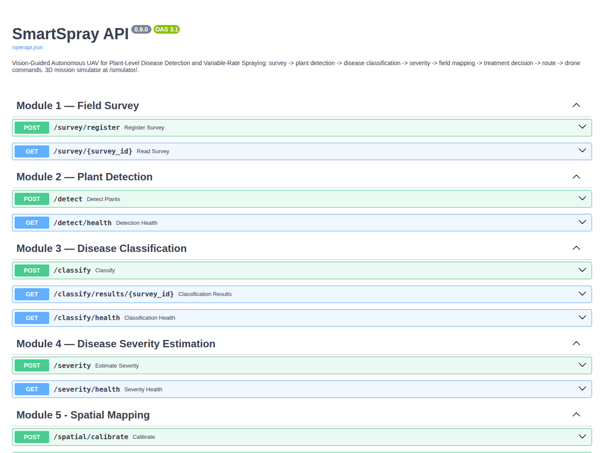

### HTML report

`app/reporting.py` writes one self-contained `report.html` per survey (images embedded, works offline, light and dark mode): key-number tiles (plants, sprays, chemical and cost saved, route), a **field map** drawn to scale in metres with every plant coloured by decision, spray-target rings, the depot and the spray route; a **per-plant decision table** (disease, confidence, severity, position, action, dose, reason, Grad-CAM thumbnail); the check against ground truth (synthetic demo); the software-in-the-loop flight result; the status of every pipeline stage; and links to the mission files.

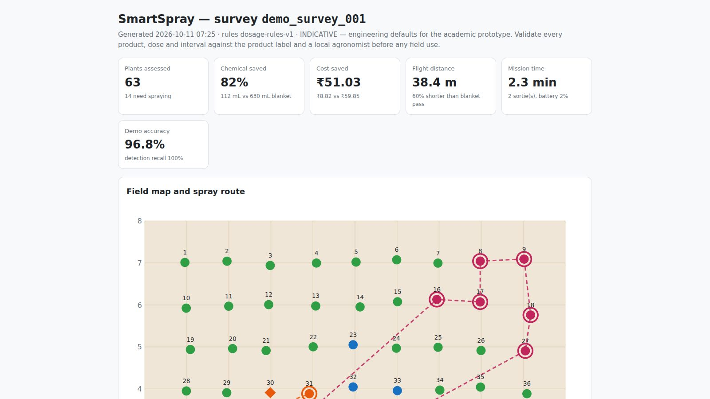

### Streamlit dashboard

`streamlit run dashboard/streamlit_app.py` opens a dashboard with five pages: **Field overview** (field map, key numbers, per-plant decisions), **Explainability** (Grad-CAM gallery), **Mission** (sorties, tank mixes, waypoint downloads, simulator), **Model card** (Module 3 metrics and figures) and **New survey** (upload images and run the pipeline). Simulated missions are stored like real surveys, so they appear in the dashboard too.

## 3D drone mission simulator

### Purpose

The simulator shows the complete mission as the drone would fly it, with the real SmartSpray modules doing the perception, decisions and planning:

1. The drone flies to the field corners the operator marked and **places ArUco markers**; it then climbs, photographs the field, learns the **boundary** and locates **every plant** (the data points).
2. It flies low and **photographs each plant**; each photo goes to the disease model, which decides **how much to spray**.
3. Plants that need no spray are skipped; the drone computes the **shortest path and time** to spray the rest and does it **autonomously**.
4. A pilot can take **manual control** from the keyboard at any time and hand control back.

```bash
uvicorn app.main:app --reload
# open http://127.0.0.1:8000/simulator/          (add ?quality=low on an older laptop)
```

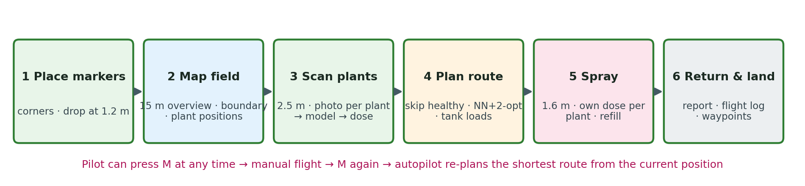

### Architecture

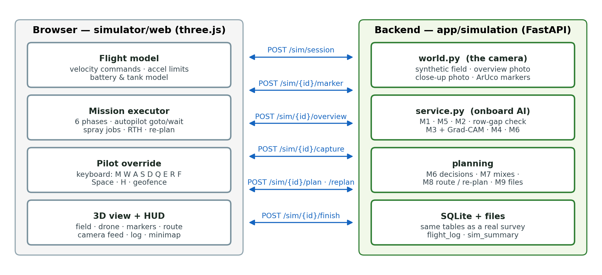

The work is split the way a real system would split it:

- **The browser is the drone and the ground station** (`simulator/web/`): flight dynamics, the mission executor and autopilot, the pilot's keyboard, and the 3D view. three.js r186 is bundled locally (`vendor/three.bundle.min.js`), so the page works offline.
- **The backend is the drone's camera and onboard AI** (`app/simulation/`): `world.py` renders the synthetic field and every photo the drone takes; `service.py` runs the real modules on those photos and stores everything in the same database tables as a real survey.

### Synthetic world (`app/simulation/world.py`)

| Item | Value |
|---|---|
| Field presets | Field A/B: 7 rows × 9 plants on 10 m × 8 m (63 plants); Field C: 9 × 13 on 14 m × 10 m (117 plants); 1 m spacing with ±8 cm jitter |
| Disease layout | Field A = scripted demo layout (6 late blight, 7 early blight, 6 septoria, 44 healthy); B/C = one randomly grown patch per disease (~9 % of plants each) |
| Plant photos | Real PlantVillage **test-split** photos, never reused within a field; canopy 0.855 m |
| Ground texture | 220 px/m: soil, furrows between rows, plants, and every dropped marker where it landed |
| Markers | ArUco `DICT_4X4_50` ids 0–3, 0.60 m black square + 0.12 m white border |
| Overview photo (from 15 m) | texture down-sampled to 110 px/m + lighting gradient + sensor noise + 1.5–3 % perspective tilt |
| Close-up photo (from 2.5 m) | 1.6 m × 1.6 m footprint at 220 px/m (352 × 352 px) centred on the drone's actual position; gain ±5 %, noise, slight blur |
| Home pad / refill station | (−2.0, −1.6) m, outside the south-west corner |

### Mission phases in detail

**Phase 1 — Place markers.** Take-off to 3 m; for each planned corner: fly there, descend to 1.2 m, release a marker (it falls under gravity and lands within ±3 cm of the release point), report the landing point (`POST /sim/{id}/marker`), climb back.

**Phase 2 — Map field.** Climb to 15 m over the field centre and take the overview photo (`POST /sim/{id}/overview`). The backend:

1. saves the photo as a survey image and registers the survey (M1, including the blur check), with the field size measured between the dropped markers;
2. detects the four markers and solves the homography (M5) — the **boundary and true field size**;
3. detects every plant (M2 vegetation detector, kernel 0.004) and maps each box centre to metres (M5) — the **data points**;
4. runs a **row check**: plants are in rows at regular spacing, so a hole in a row (gap > 1.5 × the median spacing) or a short row probably hides a plant the detector missed; those spots are added to the low pass as "gap" targets;
5. orders all targets **row by row** (serpentine, starting from the south row nearest home);
6. scores the mapping against ground truth (synthetic field only): plants matched within 0.45 m, mean position error.

The boundary is drawn, its measured size is labelled, and a pin appears at every located plant.

**Phase 3 — Scan plants.** At 2.5 m and 2 m/s the drone stops over each target (7 cm tolerance), hovers 0.2 s and takes a close-up (`POST /sim/{id}/capture` with its actual position). The request runs while the drone flies on to the next plant (at most six photos are processed at once). For each photo the backend:

1. **locates the plant** with a plant-versus-soil colour model (soil = hue 3–24, saturation ≥ 60, value 40–190; everything else is plant), keeping the blob nearest the photo centre within 0.35 m; this crops the whole plant, including brown and pale diseased tissue (fallback: the M2 vegetation detector);
2. computes the plant's position from the photo (drone position + pixel offset / 220 px/m); a plant found at a "gap" target is added as a new plant (`low-pass-recovered`);
3. classifies the crop with the **Module 3 classifier** (TTA + temperature) and, if enabled, computes **Grad-CAM**;
4. estimates **severity** (M4) and applies the **dosage rules** (M6) to get the action, dose, treatment and reason;
5. stores the classification and severity rows and the photos (`data/outputs/<sim_id>/closeups/`).

The capture card shows the photo (or its Grad-CAM), the disease, the confidence bar, all four probabilities, the severity, the decision and its reason. The plant's ring in 3D turns green (healthy), yellow (monitor), orange or red (spray target, by treatment) or violet (inspect), with the dose as a floating label.

**Phase 4 — Plan route** (`POST /sim/{id}/plan`): re-map (to include recovered plants), decide every plant (M6; the re-treatment check is skipped because each synthetic field is a different field), build tank mixes (M7), plan the shortest capacity-aware route from the home pad (M8) and write the command queue and QGroundControl files (M9). The route is drawn in 3D and on the minimap, with the comparison to the blanket pass.

**Phase 5 — Spray.** For each sortie: fly home, land, load the mix (sortie load + 5 %), wait the 60 s refill (shown with an 8× time-warp; the battery is swapped if below 50 %), take off, and fly the route at 1.6 m. Over each target the drone hovers and sprays its own dose at 5 mL/s; spray particles, the tank gauge and a "wet" disc show it. If a plant was already partly sprayed (for example by the pilot), only the missing amount is topped up; if the tank cannot cover the next target, the route is re-planned.

**Phase 6 — Return and land**, then `POST /sim/{id}/finish` saves the flight log and returns the mission report: chemical used vs blanket, spray-route distance vs the lawn-mower pass, flight time, battery, what the pilot did, and the check against ground truth.

### Flight model and autopilot (`simulator/web/js/drone.js`, `mission.js`)

| Item | Model |
|---|---|
| Control | Velocity commands (x, y, z, yaw rate), like a multirotor flight controller in velocity mode |
| Limits | horizontal acceleration 3 m/s²; vertical speed 1.8 m/s, vertical acceleration 2 m/s²; yaw rate 1.8 rad/s; ground at 0 m |
| Power / battery | P = hover + (cruise − hover) · min(1.6, (v / 3)²) + 25 W per m/s of climb; 90 Wh battery; energy integrated every step |
| Physics step | fixed 1/60 s simulated; speed ×1, ×2, ×4, ×8; simulated time pauses (is not lost) while the drone waits for the model or the planner |
| Auto "go to" | speed = min(cruise, 0.92 · √(2 · 2.4 · d), 4d + 0.05) toward the target, so it slows smoothly on arrival; climb rate = clamp(1.6 · Δz, ±1.4); faces the direction of travel on legs over 0.7 m; arrived when within tolerance, height within 6 cm and nearly stopped |
| Visuals | body tilts with velocity and acceleration; rotors spin; tank liquid level and colour follow the loaded mix |

### Pilot override

| Key | Action |
|---|---|
| `M` | take manual control / hand back to the autopilot |
| `W` `A` `S` `D` or arrows | forward, left, back, right relative to the drone's heading (2.2 m/s; `Shift` 4.5 m/s) |
| `Q` `E` | turn left / right |
| `R` `F` | climb / descend (1.3 m/s); `F` on the ground stops the motors |
| `Space` | spray (hold): the dose goes to the plant under the drone (within 0.5 m) |
| `H` | return to home and land |
| `P` | pause |
| `1` `2` `3` `4` / `0` | camera: follow, top, orbit (mouse), FPV / automatic |

Safety and bookkeeping while the pilot flies: the autopilot is suspended and the drone holds position when no key is pressed; a **geofence** blocks movement more than 3 m outside the marked field (and home pad); the altitude is capped at 25 m; every hand-sprayed millilitre is credited to the plant under the drone and logged as on-target, off-target or on bare soil. When the pilot presses `M` during the spray phase, the browser sends the drone's position, the mix left in the tank and the targets not yet fully sprayed to `POST /sim/{id}/replan`; the backend returns the shortest route from that position (Module 8 re-planning) and the drone continues. A battery below 20 % triggers an automatic return home.

### User interface

Phase stepper and a one-line explanation of the current step; mode badge (AUTO / MANUAL / RETURN HOME / PAUSED); telemetry (phase, flight time, altitude, speed, position, distance, battery, tank and mix, markers, plants found, photographed, sprayed); plant-status legend; live **gimbal camera** feed (picture-in-picture), which shows the overview photo with its detections after mapping; capture card with a film strip of recent photos; event log; 2D minimap with the boundary, plants, route and drone; 3D labels (markers, field size, doses); end-of-mission report with download links (waypoints, flight log, summary).

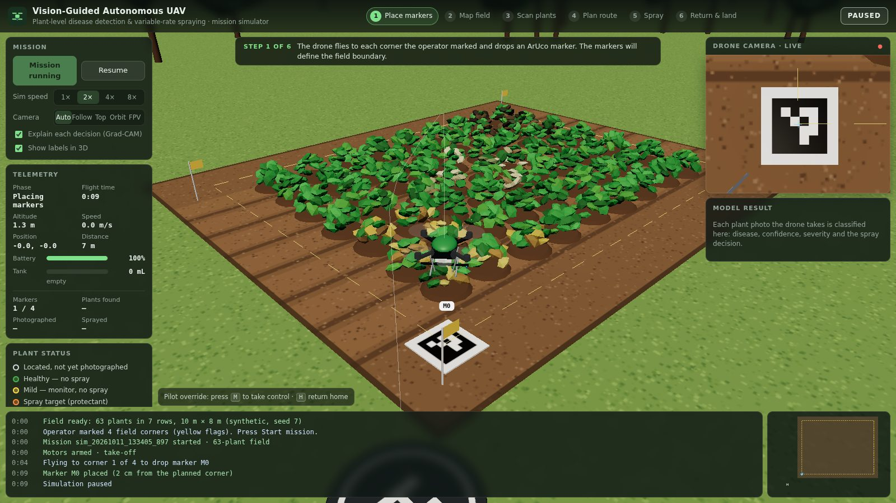

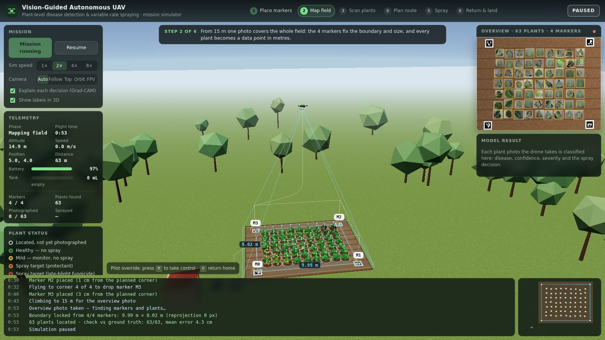

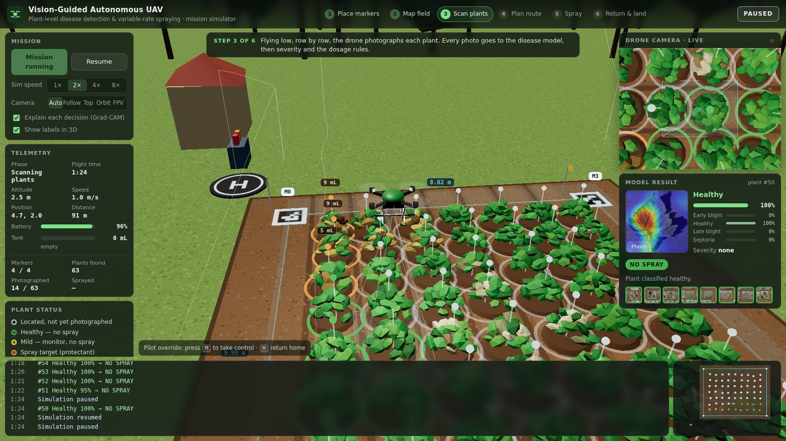

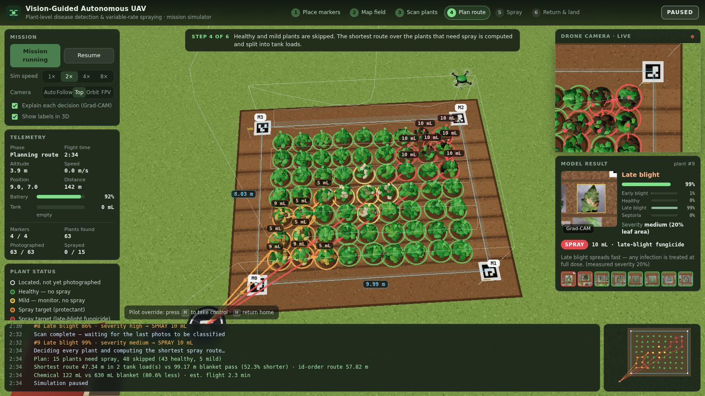

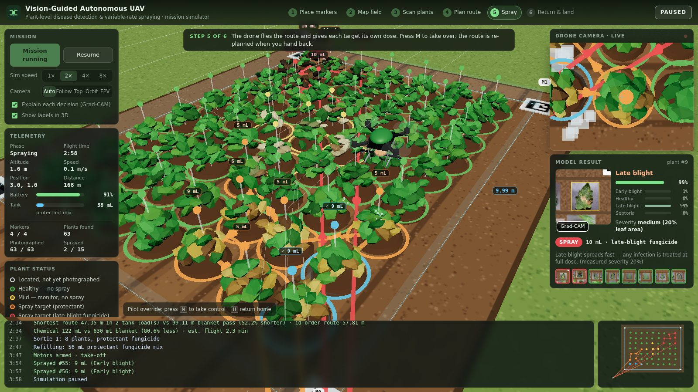

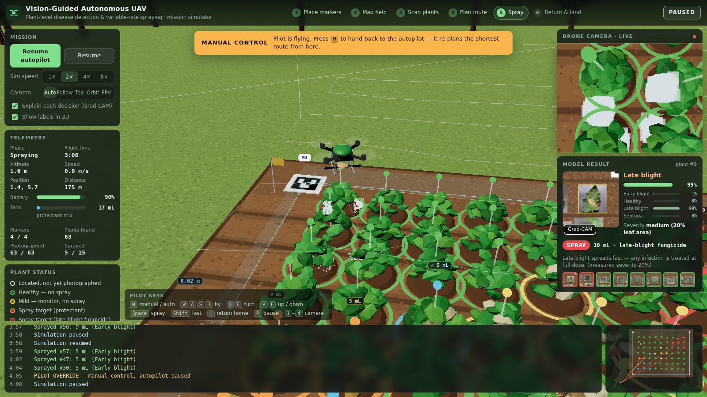

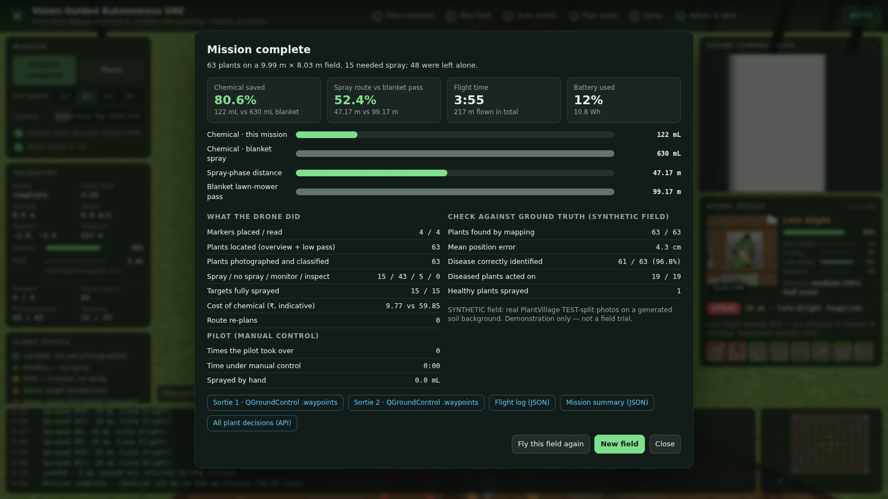

### Simulator API and files

| Endpoint | Step |
|---|---|
| `POST /sim/session` `{seed, preset}` | new synthetic field (`small` or `medium`) |
| `POST /sim/{id}/marker` `{marker_id, x_m, y_m}` | a marker landed |
| `POST /sim/{id}/overview` | overview photo → boundary, size, plants, scan order |
| `POST /sim/{id}/capture` `{target_id, drone_x_m, drone_y_m, gradcam}` | close-up → disease, confidence, severity, decision, Grad-CAM |
| `POST /sim/{id}/plan` | decisions + route + waypoint files |
| `POST /sim/{id}/replan` `{position, tank_ml, tank_treatment, remaining}` | route from the current position |
| `POST /sim/{id}/finish` `{telemetry}` | flight log + mission report |
| `GET /sim/{id}/state` · `/sim/{id}/files/{name}` · `/sim/aruco/{id}.png` | state · overview / close-ups / logs · marker images |

Per mission: `data/images/sim_<id>/overview.jpg`; `data/outputs/sim_<id>/closeups/`, `mission/` (commands + `.waypoints`), `flight_log.json` (events, track, mL per plant, re-plans), `sim_summary.json`, `sim_state.json`. Old missions are removed with `python scripts/clean_simulations.py` (keeps the 5 most recent; `--keep 0` removes all).

**Performance.** One close-up (render + locate + classify with TTA + severity + Grad-CAM + JPEG encoding) takes about 0.35 s on a 2-core cloud CPU and less on an Apple-silicon Mac; the model is warmed up in the background when a mission is prepared.

## Testing and verification

### Automated tests

```bash
pytest -q                                  # all 277 tests, about 1 minute
pytest tests/test_classification.py -v     # one module, verbose
```

| Test file | Tests | Covers |
|---|---|---|
| `test_field_survey.py` | 5 | registration, duplicate ids, image quality check |
| `test_detection.py` | 28 | YOLO wrapper, OpenCV fallback, plant-ID ordering (incl. tilted rows), DB, API |
| `test_classification.py` | 36 | data contracts, class-order guard, inference config, TTA, temperature, uncertainty flag, DB, API, real-model checks |
| `test_severity.py` | 39 | severity bands, disease profiles, invalid crops, DB, API |
| `test_spatial_mapping.py` | 104 (incl. parametrised) | homography maths, marker layouts, reprojection checks, uncalibrated mode, DB, API |
| `test_decision.py` | 19 | every branch of the decision order, rule-file validation, savings summary |
| `test_resource_optimization.py` | 4 | grouping, tank loads, mix plan |
| `test_mission_planner.py` | 12 | NN, 2-opt, capacity splits, baseline never beaten, blocked/partial plans |
| `test_drone_integration.py` | 5 | command queue, waypoint format, GPS conversion, executor |
| `test_simulation.py` | 16 | synthetic world, row-gap check, serpentine order, re-planning, rendering → calibration/detection, full mission through the API, security checks, simulated sprays kept out of real re-treatment checks |
| **Total collected** | **277** | all passing |

Tests that need the trained weights or the dataset skip themselves automatically when those files are missing.

### End-to-end verification

| Check | Result |
|---|---|
| `python scripts/run_demo.py --fresh` (all 9 stages + SITL) | all stages `success`; numbers in Chapter 18 |
| API smoke test (health, classify/health, detect/health, decisions, report, waypoints, path traversal, unknown survey) | all as expected (200 / 404) |
| Headless-browser simulator missions (Chromium + Playwright, WebGL) | full autonomous missions on Field A; a mission with **return-home during the scan + manual flight and hand-spraying during the spray phase + re-plan**: all spray targets fully sprayed, every pilot action logged |
| Model promotion | old/new model SHA-256 recorded, candidate verified before copy |
| Sync to the user's machine | content digest of every synced file verified on both sides |


## Consolidated results

### Module-level results

| Module | Metric | Result | Source |
|---|---|---|---|
| M2 YOLOv8n | test mAP50 / mAP50-95 | 0.925 / 0.805 | `models/yolov8_plant_detector/eval/metrics.json` |
| M2 YOLOv8n | test precision / recall | 0.997 / 0.912 | same |
| M2 OpenCV fallback | demo field recall / precision | 1.00 / 1.00 (63/63) | `data/outputs/demo_survey_001/demo_ground_truth_evaluation.json` |
| M3 classifier | test accuracy (752 images) | **97.34 %** | `models/classification/eval/metrics.json` |
| M3 classifier | macro F1 / weighted F1 | 0.968 / 0.973 | same |
| M3 production mode | accuracy, ECE | 97.87 %, 0.0107 | same |
| M3 uncertainty gate | coverage / accuracy when confident | 98.7 % / 98.65 % | same |
| M3 on synthetic field crops | accuracy | 98.4 % (62/63) | demo evaluation |
| M5 mapping | mean / max position error | 5.5 cm / 25 cm | demo evaluation |
| M6 decisions | diseased plants acted on / healthy sprayed | 19/19 / 0/44 | demo evaluation |
| M6 chemical | used vs blanket | 112 mL vs 630 mL (**82.2 % less**) | pipeline result |
| M6 cost | used vs blanket | ₹8.82 vs ₹59.85 | pipeline result |
| M8 route | optimised vs lawn-mower | 38.4 m vs 95.0 m (**59.6 % shorter**); 16.8 % shorter than id order | pipeline result |
| M9 SITL | flight / battery / placement error | 135 s · 3.8 % · 5 cm, no safety violations | `mission/simulation_log.json` |

### 3D simulator (Field A, 63 plants)

Results of the documented autonomous run whose end-of-mission report is shown in Chapter 16 (values vary slightly between runs because marker drops and photo noise are random):

| Item | Result |
|---|---|
| Markers placed / read | 4 / 4; boundary measured as 9.99 m × 8.03 m (true 10 m × 8 m) |
| Plants located | 63 / 63, mean position error 4.3 cm |
| Plants photographed and classified | 63; 61 / 63 correct (96.8 %) |
| Decisions | 15 spray, 43 no spray, 5 monitor, 0 inspect; 19 / 19 diseased plants acted on; 1 healthy plant sprayed (misclassified as diseased) |
| Chemical | 122 mL vs 630 mL blanket (**80.6 % less**); ₹9.77 vs ₹59.85 |
| Spray route | 47.2 m vs 99.2 m lawn-mower pass from the home pad (**52.4 % shorter**), 2 tank loads |
| Mission | flight time 3 min 55 s, 217 m flown in total (markers, mapping, scan, spraying), 12 % battery (10.8 Wh) |
| With pilot override (separate run) | return-home during the scan, manual flight and hand-spraying during the spray phase, then hand-back: the route was re-planned from the drone's position and every spray target was completed; each pilot action is in the flight log |

### What the results show

1. **Plant-level treatment works end to end**: on the demo field only 14 of 63 plants were sprayed, all 19 diseased plants were acted on (sprayed, monitored or inspected), and no healthy plant was sprayed.
2. **The savings come from two places**: dose (only targets, each at its own dose) and distance (only targets, on the shortest capacity-aware route).
3. **The safety mechanisms trigger as designed**: uncertain predictions go to manual inspection; invalid severity follows a documented policy; uncalibrated surveys are blocked rather than guessed.
4. **The classifier is reliable in its training domain** (single-leaf photos), and the system is honest about the domain gap on real field photos (Chapter 21).

## Operating guide: terminal commands for every module

All commands are run from the project folder with the virtual environment active.

### Setup (once)

```bash
cd ~/Downloads/SmartSpray-main
python3.11 -m venv .venv
source .venv/bin/activate              # Windows: .venv\Scripts\activate
python -m pip install --upgrade pip
pip install -r requirements.txt
```

Every new terminal window needs `cd ~/Downloads/SmartSpray-main` and `source .venv/bin/activate` again.

### One-command demo

```bash
python scripts/run_demo.py --fresh                  # builds the synthetic field, runs M1-M9 + SITL
open data/outputs/demo_survey_001/report.html       # macOS; on Windows: start ...
```

### The API server

```bash
uvicorn app.main:app --reload                       # http://127.0.0.1:8000
# docs:       http://127.0.0.1:8000/docs
# simulator:  http://127.0.0.1:8000/simulator/
# report:     http://127.0.0.1:8000/reports/demo_survey_001
```

Stop it with `Ctrl+C`. Use `--port 8001` if port 8000 is busy. Leave this terminal running and open a second one for the commands below.

### Running each module through the API (curl)

The commands below re-run every module, one at a time, on the demo survey (run the demo once first). Each returns JSON; pipe into `python -m json.tool` to pretty-print.

```bash
H='Content-Type: application/json'
API=http://127.0.0.1:8000
S='"survey_id":"demo_survey_001"'

# M1  survey record
curl -s $API/survey/demo_survey_001 | python -m json.tool

# M2  detect plants (classical detector for the synthetic field)
curl -s -X POST $API/detect -H "$H" -d "{$S,\"detector\":\"classical\"}" | python -m json.tool | head -30

# M3  classify every plant (+ Grad-CAM files), then read the results
curl -s -X POST $API/classify -H "$H" -d "{$S,\"save_gradcam\":true}" | python -m json.tool | head -40
curl -s $API/classify/results/demo_survey_001 | python -m json.tool | head -40
curl -s $API/classify/health | python -m json.tool

# M4  severity
curl -s -X POST $API/severity -H "$H" -d "{$S}" | python -m json.tool | head -30

# M5  calibrate from the ArUco markers, then map plants to metres
curl -s -X POST $API/spatial/calibrate -H "$H" \
     -d "{$S,\"image_filename\":\"field_orthomosaic.jpg\",\"field_width_m\":10,\"field_height_m\":8}" | python -m json.tool
curl -s -X POST $API/spatial/map -H "$H" -d "{$S}" | python -m json.tool | head -30

# M6  decisions (+ the active rule table)
curl -s -X POST $API/decisions/generate -H "$H" -d "{$S}" | python -m json.tool | head -60
curl -s $API/decisions/rules/current | python -m json.tool | head -40

# M7 + M8  tank mixes and route
curl -s -X POST $API/mission/plan -H "$H" -d "{$S}" | python -m json.tool | head -60
curl -s $API/resources/demo_survey_001 | python -m json.tool

# M9  commands, waypoint file, software-in-the-loop flight
curl -s -X POST $API/drone/commands/generate -H "$H" -d "{$S}" | python -m json.tool | head -30
curl -s $API/drone/mission/demo_survey_001/1.waypoints
curl -s -X POST $API/drone/simulate -H "$H" -d "{$S}" | python -m json.tool | head -30

# everything at once
curl -s -X POST $API/pipeline/run -H "$H" \
     -d "{$S,\"detector\":\"classical\",\"save_gradcam\":true,\"simulate\":true}" | python -m json.tool | head -40
```

To run on your own images: put 5–10 photos in `data/images/survey_002/`, register with `curl -s -X POST $API/survey/register -H "$H" -d '{"survey_id":"survey_002","field_width_m":10,"field_height_m":8}'`, then call `/pipeline/run` with `"detector":"auto"`.

### Running each module directly in Python (no server needed)

```bash
# M1
python -c "import app; from app.field_survey.service import get_survey; print(get_survey('demo_survey_001'))"
# M2
python -c "import app; from app.detection.detector import get_detector; d = get_detector('classical'); print(len(d.detect('data/images/demo_survey_001/field_orthomosaic.jpg')), 'plants')"
# M3
python -c "import app; from app.classification.service import classify_survey; r = classify_survey('demo_survey_001'); print(r['classified'], 'classified,', r['uncertain'], 'uncertain')"
# M4
python -c "import app; from app.severity.service import estimate_survey; r = estimate_survey('demo_survey_001'); print(sum(x.is_valid for x in r), 'valid of', len(r))"
# M5
python -c "import app; from app.spatial_mapping.mapper import map_survey, summarise; print(summarise(map_survey('demo_survey_001')))"
# M6
python -c "import app; from app.decision.service import generate_decisions; print(generate_decisions('demo_survey_001')['summary'])"
# M7 + M8
python -c "import app; from app.mission_planner.service import plan_mission; print(plan_mission('demo_survey_001')['metrics'])"
# M9
python -c "import app; from app.drone_integration.command_queue import generate_commands; print(generate_commands('demo_survey_001')['files'])"
python -m simulator.executor_simulator demo_survey_001 --noise 0.05 --seed 7
# all stages
python -m app.pipeline demo_survey_001 --detector classical --gradcam --simulate --report
```

### Showing how one plant is classified (review demonstration)

```bash
python scripts/inspect_classifier.py                          # random test photo
python scripts/inspect_classifier.py --label early_blight     # random photo of one class
python scripts/inspect_classifier.py --survey demo_survey_001 --plant 12
python scripts/inspect_classifier.py "data/datasets/plantvillage_tomato/healthy/<file>.JPG"
open data/outputs/inspect/                                    # the Grad-CAM images it saved
```

It prints the nine steps of Section 7.7: model file and hash, layers, inference settings, pre-processing, both forward passes, the TTA average, temperature scaling, the final prediction, severity, the treatment decision, and where the Grad-CAM was saved.

### Looking inside the database

```bash
sqlite3 database/smartspray.db ".tables"
sqlite3 -header -column database/smartspray.db \
  "SELECT plant_id, label, ROUND(confidence,3) AS conf, is_uncertain FROM classifications WHERE survey_id='demo_survey_001' LIMIT 10;"
sqlite3 -header -column database/smartspray.db \
  "SELECT action, COUNT(*) AS plants, SUM(dosage_ml) AS ml FROM treatment_decisions WHERE survey_id='demo_survey_001' GROUP BY action;"
sqlite3 -header -column database/smartspray.db \
  "SELECT plant_id, ROUND(field_x_m,2) x, ROUND(field_y_m,2) y, mapping_mode FROM plant_locations WHERE survey_id='demo_survey_001' LIMIT 10;"
```

`sqlite3` is built into macOS. Without it (e.g. on Windows), use Python instead:

```bash
python -c "import sqlite3; c = sqlite3.connect('database/smartspray.db'); print(c.execute(\"SELECT action, COUNT(*) FROM treatment_decisions WHERE survey_id='demo_survey_001' GROUP BY action\").fetchall())"
```

### Opening the code

```bash
code .                                   # VS Code (if installed): whole project
open -a TextEdit app/classification/classifier.py
less app/decision/rules_engine.py        # q to quit
```

| To show… | Open |
|---|---|
| How a plant is classified | `app/classification/classifier.py` (`_prepare`, `_forward`, `predict_batch`), `app/classification/service.py` (`classify_survey`) |
| The model architecture | `app/classification/model_factory.py` |
| How training and the split work | `scripts/m3_train_classifier.py` |
| Grad-CAM | `app/classification/explain.py` |
| Severity | `app/severity/estimator.py` |
| Markers → metres | `app/spatial_mapping/calibration.py`, `mapper.py` |
| The dose rules | `rules/dosage_rules.json`, `app/decision/rules_engine.py` |
| Shortest route | `app/mission_planner/route_optimizer.py` |
| Drone file format | `app/drone_integration/command_queue.py` |
| The whole pipeline | `app/pipeline.py` |
| The simulator | `app/simulation/service.py` (backend), `simulator/web/js/mission.js` (autopilot + pilot), `simulator/web/js/drone.js` (flight model) |

### Re-training the models

```bash
# Module 3 (EfficientNetB0, 70/15/15)
python scripts/m3_train_classifier.py --stage split      # de-duplicate + split + manifest
python scripts/m3_train_classifier.py --stage train      # phases 1 + 2
python scripts/m3_train_classifier.py --stage deep       # phase 3 (kept only if validation improves)
python scripts/m3_train_classifier.py --stage evaluate   # the single test pass (then locked)
python scripts/m3_train_classifier.py --stage promote    # backup + SHA-256 + copy to best.keras
python scripts/build_m3_report_notebook.py               # executed report notebook
python scripts/write_m3_report.py                        # docs/MODULE3_REPORT.md

# Module 2 (YOLOv8n)
python scripts/m2_train_detector.py --epochs 50 --imgsz 640 --device mps    # Apple GPU; or --device cpu
```

The test split is locked by `models/classification/eval/TEST_EVALUATED.lock`; delete it only when deliberately starting a new, documented experiment.

### Dashboard, notebook, simulator, tests

```bash
streamlit run dashboard/streamlit_app.py                 # dashboard (second terminal)
pip install notebook && jupyter notebook notebooks/m3_classification_701515_report.ipynb
uvicorn app.main:app --reload   → open http://127.0.0.1:8000/simulator/
pytest -q                                                # all tests
python scripts/clean_simulations.py --keep 5             # remove old simulated missions
```

### Troubleshooting

| Symptom | Fix |
|---|---|
| `zsh: command not found: uvicorn` / `No module named fastapi` | activate the environment: `source .venv/bin/activate` |
| `No module named app` | run commands from the project folder (`cd ~/Downloads/SmartSpray-main`) |
| `Address already in use` | another server is running: stop it with `Ctrl+C`, or use `--port 8001` |
| Simulator page says "Backend not reachable" | start `uvicorn app.main:app --reload` and open the page from `http://127.0.0.1:8000/simulator/` |
| Simulator slow on an old laptop | open `http://127.0.0.1:8000/simulator/?quality=low` |
| `Model weights not found` | `models/classification/best.keras` is missing: copy it back or retrain |
| `No plant detections found` | run Module 2 first (or the pipeline) |
| Mission plan `blocked_uncalibrated` | the images have no readable ArUco markers: calibrate with `/spatial/calibrate` |

## Review preparation: likely questions and answers

**Q1. How exactly is a plant classified in the backend?**
The plant's bounding box from Module 2 is cropped from the survey image; the crop is converted from BGR to RGB and resized to 224 × 224; it and its mirror image go through EfficientNetB0 and the classification head in one batch; the two softmax outputs are averaged; the average is re-scaled with temperature T = 0.901; the class with the highest probability is the label and that probability is the confidence; if the confidence is below 0.60 the plant is flagged uncertain. The result is stored in the `classifications` table. Demonstrate with `python scripts/inspect_classifier.py` (Section 7.7).

**Q2. Why EfficientNetB0?**
It gives ImageNet-quality features with about 4 million parameters (ResNet-50 has about 25 million, VGG-16 about 138 million), so it trains in about an hour on a CPU and runs in tens of milliseconds per plant on a laptop or edge device, while being more accurate than MobileNet-class models of similar size.

**Q3. Why transfer learning instead of training from scratch?**
About 3,500 training images are far too few to learn general visual features from scratch. Starting from ImageNet features and fine-tuning only the upper layers converges fast and generalises better.

**Q4. Why 70/15/15, and what was wrong with 80/20?**
With only train and validation, the model is chosen on the validation set, so the validation score is optimistic. A separate test set, never used for any decision and evaluated once, gives an unbiased estimate. 70/15/15 keeps enough training data while giving 751 validation and 752 test images.

**Q5. How did you prevent data leakage?**
Exact duplicates were removed by SHA-256 before splitting; the split is stratified and seeded; path and hash overlaps between all splits were checked and are zero; augmentation is applied to training only; the test split is not even loaded during training; and a lock file prevents re-using it.

**Q6. Why is production accuracy (97.87 %) higher than the reported 97.34 %?**
97.34 % is the plain model. Production adds flip-TTA (chosen on validation), which averages two views and corrects a few borderline cases. Both are reported; neither was tuned on the test set.

**Q7. What is temperature scaling and why is T below 1?**
It divides the log-probabilities by a single number T fitted on validation data to make confidences match observed accuracy. T = 0.901 < 1 sharpens the probabilities, meaning the raw model was slightly under-confident. It never changes the predicted class.

**Q8. What happens when the model is not sure?**
Confidence below 0.60 sets `is_uncertain`; Module 6 then returns **inspect** and the plant is never sprayed automatically. On the test set, 10 plants were flagged and 6 of them were wrong predictions.

**Q9. What is Grad-CAM?**
It takes the gradient of the predicted class score with respect to the last convolutional feature maps, averages it per map to get importance weights, and forms a weighted sum of the maps; after a ReLU and upsampling this is a heatmap of the regions that supported the prediction. It is used to check that the model looks at lesions, and it revealed the domain gap on real greenhouse photos.

**Q10. How is severity measured, and is it accurate?**
Leaf pixels are segmented by colour, lesion pixels by disease-specific colour rules inside the leaf, and severity = lesion / leaf area, graded at 20 % and 50 %. It is a transparent heuristic; no labelled severity data was available, so no accuracy is claimed and it is listed as future work.

**Q11. How do you get positions in metres?**
Four ArUco markers at known field corners are detected in the image; their centres give four image–field point pairs, from which OpenCV computes a homography (a 3 × 3 projective transform). Every plant's box centre is multiplied by it to get (x, y) in metres. The demo error is 5.5 cm on average.

**Q12. Why ArUco and not GPS?**
Consumer GPS is accurate to 2–5 m, which is larger than the 1 m plant spacing. ArUco markers give centimetre-level accuracy with a normal camera and no extra hardware. RTK-GPS (2 cm) is the planned upgrade and would replace only Module 5.

**Q13. How is the dose decided, and who sets the rules?**
By an ordered rule table in `rules/dosage_rules.json`: healthy → no spray; unsure → inspect; disease × severity → monitor or spray with a dose; late blight always treated. Agronomists can edit the JSON without touching code, and every decision records the rule version and a reason.

**Q14. How is the route optimised? Why not an exact solver?**
Nearest-neighbour construction plus 2-opt improvement, cut into tank-sized sorties and optimised again. The exact travelling-salesman problem is NP-hard; for tens of plants 2-opt runs in milliseconds and is typically within a few percent of optimal without any external solver. The plant-id order is always a candidate, so the result is never worse than the naive route.

**Q15. How does tank capacity affect the plan?**
Usable capacity is 237.5 mL (250 mL minus 5 % reserve). Targets of the same treatment are split into consecutive sorties whose total dose fits; different treatments use different sorties because mixes cannot share a tank.

**Q16. How would this connect to a real drone?**
Module 9 writes standard MAVLink missions (`QGC WPL 110`): `NAV_TAKEOFF` (22), `NAV_WAYPOINT` (16) to each plant, `DO_SPRAYER` (216) on, hover for the spray time, `DO_SPRAYER` off, and `RETURN_TO_LAUNCH` (20). These load into QGroundControl or Mission Planner and fly on ArduPilot/PX4 drones. A live link would send the same items over MAVLink telemetry.

**Q17. Why software and not hardware?**
See Section 2.4: the innovation is the decision, the output is hardware-agnostic, hardware is costly and regulated, software is reproducible and testable, and the design keeps a slot for hardware integration.

**Q18. What in the 3D simulator is real and what is simulated?**
Real: ArUco calibration, plant detection, the disease classifier and Grad-CAM, severity, dosage rules, tank mixes, route optimiser, re-planning and waypoint export. Simulated: the field (real test photos on generated soil), the camera images, the flight dynamics, battery and nozzle.

**Q19. How do the manual override and re-planning work?**
`M` suspends the autopilot; the keys send velocity commands; a geofence keeps the drone near the field; sprayed millilitres are credited to the plant under the drone. Pressing `M` again sends the drone's position, remaining mix and unfinished targets to `/sim/{id}/replan`, which returns the shortest route from that position (Module 8, open-path 2-opt), and the autopilot continues.

**Q20. How do you know chemical is saved?**
The baseline is defined in the rules file: blanket spraying gives every plant 10 mL. SmartSpray's usage is the sum of the doses it actually decided (demo: 112 mL vs 630 mL). The route is compared with a lawn-mower pass covering the whole field with a 1 m swath.

**Q21. What is mAP?**
Mean average precision: the area under the precision–recall curve, averaged over classes; mAP50 counts a detection as correct at ≥ 50 % box overlap, mAP50-95 averages overlaps from 50 % to 95 %.

**Q22. What are the main limitations?**
The classifier is trained on single-leaf photos and does not transfer to real field photos without fine-tuning (Grad-CAM showed it attending to background); severity is not validated; fields are synthetic; doses and prices are placeholders; drone output is validated only in simulation.

**Q23. How would you deploy this on a real farm?**
Collect and label drone images of real plants (or use PlantDoc), fine-tune M2 and M3 on them, validate severity with an agronomist, place printed ArUco markers (or use RTK-GPS), get the dosage rules approved, fly survey missions, review the plan in the dashboard, and fly the exported mission with a licensed pilot.

**Q24. How is the system tested?**
277 automated pytest tests across all modules, an end-to-end demo with a ground-truth check, an API smoke test, and headless-browser runs of complete simulator missions including manual override and re-planning.

**Q25. How fast is it?**
About 75 ms per plant for classification with TTA and about 50 ms for Grad-CAM on a 2-core cloud CPU; the full 63-plant demo pipeline (all nine modules plus the flight simulation) runs in about 20–30 seconds; route planning takes milliseconds.

**Q26. Why SQLite and FastAPI?**
SQLite needs no server and keeps every stage's results in one file that can be inspected with standard tools; FastAPI gives typed, validated endpoints with automatic interactive documentation.

**Q27. What if a marker is missing or moved?**
Fewer than four markers, or a reprojection error above 25 px, makes the calibration invalid; plants stay unmapped with NULL positions and the mission is blocked. The system never invents coordinates.

**Q28. What was the hardest problem?**
Making the evaluation trustworthy: removing duplicates, building a real held-out test set, and choosing every setting on validation only. In the simulator, cropping the whole plant (not just its green part) at close range was key: it raised accuracy on the simulated photos from about 95 % to about 99 %.

## Limitations and future work

### Limitations

1. **Domain gap.** PlantVillage photos are single leaves on plain backgrounds. On six real greenhouse photos from the LeafPest test set, YOLOv8 found the plants correctly, but the classifier labelled most of them as diseased and Grad-CAM showed attention on irrigation pipes and background. The uncertainty gate and the inspect action limit the damage, but real deployment needs fine-tuning on labelled field crops.
2. **Severity** is a colour heuristic without ground-truth validation.
3. **Synthetic fields.** The demo and simulator fields are made from real test-split photos on generated soil; they demonstrate and measure the pipeline but are not a field trial.
4. **Placeholder parameters.** Doses, prices, tank, battery and power values in `rules/` are engineering defaults; they must be checked against product labels, an agronomist and the real airframe.
5. **Simulation only.** Drone output has been validated in software (SITL executor and 3D simulator), with no wind, GPS error or obstacles modelled.
6. **Marker dependence.** Positions need four visible markers (or a future RTK-GPS module).

### Remaining work (≈ 25 %)

| Item | Plan |
|---|---|
| Field imagery and field-trained models | collect and label drone crops or use PlantDoc; fine-tune M2 and M3; re-evaluate on held-out field images |
| Severity validation | agronomist-labelled severity scores; compare and calibrate the heuristic or train a segmentation model |
| Live drone link | send the MAVLink mission over telemetry; real pump and nozzle control |
| RTK-GPS positioning | replace marker calibration with geotagged images |
| Weather-aware spraying | block spraying in wind or rain; time windows |
| Simulator realism | wind, GPS noise, obstacles, camera perspective and motion blur |
| Multi-field accounts | field identities for the re-treatment check across surveys, user roles |

## References

1. Hughes, D. P., & Salathé, M. (2015). An open access repository of images on plant health to enable the development of mobile disease diagnostics. *arXiv:1511.08060*.
2. Mohanty, S. P., Hughes, D. P., & Salathé, M. (2016). Using deep learning for image-based plant disease detection. *Frontiers in Plant Science*, 7, 1419.
3. Tan, M., & Le, Q. V. (2019). EfficientNet: Rethinking model scaling for convolutional neural networks. *Proceedings of ICML 2019*.
4. Guo, C., Pleiss, G., Sun, Y., & Weinberger, K. Q. (2017). On calibration of modern neural networks. *Proceedings of ICML 2017*.
5. Selvaraju, R. R., Cogswell, M., Das, A., Vedantam, R., Parikh, D., & Batra, D. (2017). Grad-CAM: Visual explanations from deep networks via gradient-based localization. *Proceedings of ICCV 2017*.
6. Jocher, G., Chaurasia, A., & Qiu, J. (2023). *Ultralytics YOLOv8* (software). https://github.com/ultralytics/ultralytics
7. Garrido-Jurado, S., Muñoz-Salinas, R., Madrid-Cuevas, F. J., & Marín-Jiménez, M. J. (2014). Automatic generation and detection of highly reliable fiducial markers under occlusion. *Pattern Recognition*, 47(6), 2280–2292.
8. Hartley, R., & Zisserman, A. (2004). *Multiple View Geometry in Computer Vision* (2nd ed.). Cambridge University Press.
9. Croes, G. A. (1958). A method for solving traveling-salesman problems. *Operations Research*, 6(6), 791–812.
10. Woebbecke, D. M., Meyer, G. E., Von Bargen, K., & Mortensen, D. A. (1995). Color indices for weed identification under various soil, residue, and lighting conditions. *Transactions of the ASAE*, 38(1), 259–269.
11. Singh, D., Jain, N., Jain, P., Kayal, P., Kumawat, S., & Batra, N. (2020). PlantDoc: A dataset for visual plant disease detection. *Proceedings of CoDS-COMAD 2020*.
12. LeafPest. *Plant Detection* dataset v1, Roboflow Universe, CC BY 4.0.
13. MAVLink developer guide — mission protocol and `MAV_CMD` reference; QGroundControl plan file formats. https://mavlink.io
14. Ministry of Civil Aviation, Government of India (2021). *The Drone Rules, 2021*.
15. John Deere (2024). See & Spray 59 percent herbicide savings. https://www.deere.com/en-us/john-deere-news/see-spray-59-percent-herbicide-savings
16. XBOOM. Agriculture drone price in India 2026. https://www.xboom.in/agriculture-drone-price-india/
17. Leher. Agri drone regulations and requirements in India. https://www.leher.ag/blog/agri-drone-regulations-requirements-india

## Appendix A — File-by-file reference

| File | Purpose |
|---|---|
| `app/main.py` | FastAPI application: registers all routers, `/health`, `/pipeline/run`, `/reports/{id}`, serves `/simulator/` |
| `app/pipeline.py` | runs M1–M9 for a survey; CLI `python -m app.pipeline` |
| `app/db.py` | SQLite connection (`database/smartspray.db`) and `init_db()` |
| `app/__init__.py` | import-order guard that loads `triton` before TensorFlow (avoids a crash when both are installed) |
| `app/reporting.py` | self-contained HTML report and ground-truth evaluation |
| `app/field_survey/service.py`, `router.py` | M1 registration and image quality check |
| `app/detection/detector.py` | M2 YOLOv8 wrapper, OpenCV fallback detector, `get_detector()` |
| `app/detection/identity_resolver.py` | M2 plant-ID ordering (adaptive rows) |
| `app/detection/router.py` | M2 API and `detections` table |
| `app/classification/classifier.py` | M3 inference: model loading, class-order check, inference config, TTA, temperature, uncertainty |
| `app/classification/model_factory.py` | M3 architecture and fine-tuning helpers |
| `app/classification/explain.py` | M3 Grad-CAM (compiled) and heatmap overlay |
| `app/classification/prediction.py` | M3 data contracts, class names, model version, threshold |
| `app/classification/service.py`, `database.py`, `router.py` | M3 survey workflow, storage, API |
| `app/severity/estimator.py`, `service.py`, `database.py`, `router.py` | M4 |
| `app/spatial_mapping/calibration.py`, `mapper.py`, `database.py`, `router.py` | M5 |
| `app/decision/rules_engine.py`, `service.py`, `database.py`, `router.py` | M6 (database.py also stores M7–M9 tables) |
| `app/resource_optimization/grouping.py`, `router.py` | M7 and mission configuration loader |
| `app/mission_planner/route_optimizer.py`, `service.py`, `router.py` | M8 |
| `app/drone_integration/command_queue.py`, `router.py` | M9 |
| `app/simulation/world.py`, `service.py`, `router.py` | 3D simulator backend |
| `simulator/executor_simulator.py` | software-in-the-loop executor |
| `simulator/web/index.html`, `style.css`, `js/*.js`, `vendor/three.bundle.min.js` | 3D simulator front end (main, mission, drone, world3d, ui, api) |
| `dashboard/streamlit_app.py` | Streamlit dashboard |
| `rules/dosage_rules.json`, `rules/mission_config.json` | auditable decision rules and drone parameters |
| `scripts/m3_train_classifier.py` | M3 split, training, evaluation, promotion |
| `scripts/m2_train_detector.py` | M2 YOLO training and evaluation |
| `scripts/make_demo_field.py`, `scripts/run_demo.py` | synthetic demo field and one-command demo |
| `scripts/inspect_classifier.py` | step-by-step classification of one image |
| `scripts/build_m3_report_notebook.py`, `scripts/write_m3_report.py` | M3 report notebook and Markdown report |
| `scripts/severity_diagnostics.py` | M4 diagnostics on real images |
| `scripts/clean_simulations.py` | remove old simulated missions |
| `scripts/legacy_m3/` | superseded scripts from the old 80/20 workflow (kept for the record) |
| `tests/test_*.py` | pytest suite (277 tests) |
| `docs/` | this document (`PROJECT_DOCUMENTATION.md` / `.docx`), `MODULE3_REPORT.md`, `SIMULATOR.md`, `WHY_SMARTSPRAY.md` |

## Appendix B — Configuration files

`models/classification/inference_config.json`

```json
{
  "model_version": "efficientnetb0-tomato-disease-v2-701515",
  "class_order": ["early_blight", "healthy", "late_blight", "septoria_leaf_spot"],
  "image_size": 224,
  "input": "RGB uint8 0-255, resized with cv2.resize (bilinear); EfficientNet preprocess_input is a pass-through",
  "temperature": 0.9010197026101795,
  "tta_hflip": true,
  "uncertainty_threshold": 0.6
}
```

`rules/mission_config.json`

```json
{
  "tank_capacity_ml": 250, "tank_reserve_pct": 5, "cruise_speed_mps": 3.0,
  "spray_flow_ml_per_s": 5.0, "refill_time_s": 60, "takeoff_land_time_s": 20,
  "cruise_altitude_m": 2.5, "spray_swath_m": 1.0, "depot_x_m": 0.0, "depot_y_m": 0.0,
  "origin_lat": 12.8406, "origin_lon": 80.1534,
  "battery_wh": 90, "cruise_power_w": 180, "hover_power_w": 160
}
```

`rules/dosage_rules.json` (summary; full file in the repository): version `dosage-rules-v1`; unit mL of prepared mix per plant; blanket dose 10 mL; uncertainty threshold 0.6; re-treatment interval 7 days within 0.35 m; treatments `protectant_fungicide` (₹60 per litre of mix) and `late_blight_fungicide` (₹95); invalid-severity policy late blight → spray default, others → inspect; rule table as in Chapter 10.

## Appendix C — Glossary

| Term | Meaning |
|---|---|
| ArUco marker | square black-and-white fiducial pattern that a camera can detect and identify |
| Augmentation | random changes (flip, rotation, zoom…) applied to training images to improve generalisation |
| Blanket spraying | spraying every plant with the same dose |
| Calibration (model) | making predicted confidence match observed accuracy |
| ECE | expected calibration error: average gap between confidence and accuracy over confidence bins |
| EfficientNetB0 | compact convolutional neural network used as the feature extractor |
| ExG | excess-green index 2G − R − B, used to separate vegetation from soil |
| F1 score | harmonic mean of precision and recall |
| Grad-CAM | gradient-weighted class activation map, a visual explanation of a CNN decision |
| Homography | 3 × 3 projective transform mapping one plane (image) to another (field) |
| mAP | mean average precision for object detection |
| MAVLink | messaging protocol used by ArduPilot/PX4 drones and ground stations |
| NLL | negative log-likelihood, the loss used to fit the temperature |
| Reprojection error | distance between where calibration points should be and where the homography puts them |
| SITL | software-in-the-loop: running the mission against simulated hardware |
| Sortie | one flight between two refills |
| Stratified split | split that keeps each class's proportion the same in every subset |
| Temperature scaling | dividing log-probabilities by a fitted constant T to calibrate confidences |
| TTA | test-time augmentation: predicting on several versions of an image and averaging |
| 2-opt | local-search improvement for routes that reverses segments to remove crossings |
| YOLOv8 | single-stage real-time object detector |
